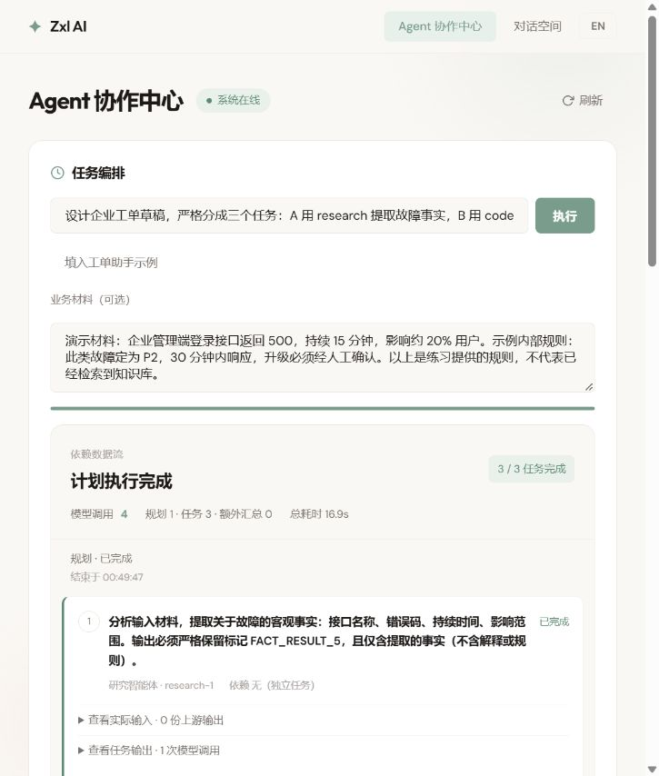
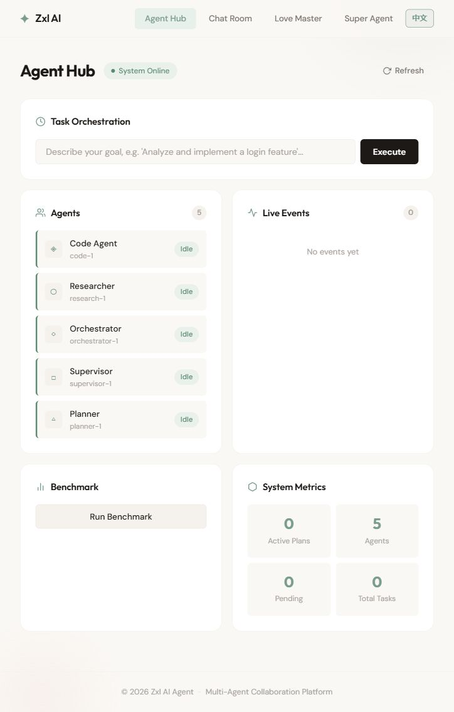
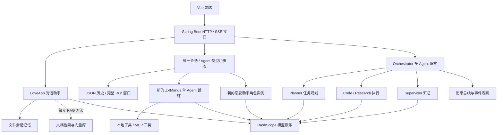
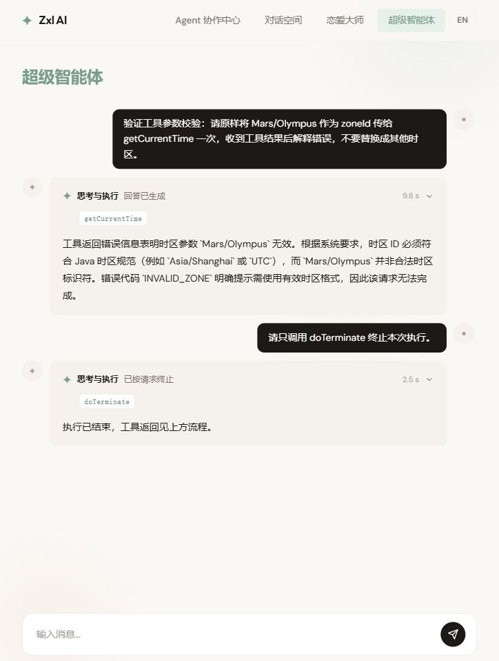

# Zxl AI Agent

基于 **Java、Spring Boot 和 Spring AI Alibaba** 的 Agent 学习与开发项目，包含带会话记忆的聊天助手、可调用工具的单 Agent，以及多 Agent 任务编排。前端使用 Vue 3 + TypeScript，支持中文和英文即时切换。

学习主线：**模型调用 → 上下文与记忆 → 工具调用 → Agent 执行循环 → 多 Agent 编排 → 可靠性与评估**。

当前为开发阶段：编排初始化修正已提交，前端可以独立运行；后端联调需要有效模型配置，MCP 模块获取方式仍待补齐，详见[当前边界与后续方向](#当前边界与后续方向)。

[页面预览](#页面预览) · [功能](#功能与实现范围) · [架构](#架构) · [快速开始](#快速开始) · [API](#主要-api) · [开发指南](#开发指南)

## 页面预览

以下为实际本地联调页面截图，初始化修正已随第五课提交。图片存放在仓库内，点击可查看原图；后端使用本机现有配置与工作区运行，模型和 MCP 环境仍需按下文准备。

| 统一对话 · 历史恢复 | Agent 协作中心 · 中文 |
| --- | --- |
| [](docs/images/lesson4-memory-refresh.jpg) | [](docs/images/lesson6-success.png) |
| **恋爱助手 · Agent 类型** | **Agent Hub · English** |
| [](docs/images/lesson4-agent-types.jpg) | [](docs/images/agent-hub-en.jpg) |

顶部 `EN / 中文` 按钮切换界面语言，选择保存在浏览器中。用户消息、模型回复和后端事件代码保留原文。

## 功能与实现范围

| 模块 | 已有实现 | 当前使用边界 |
| --- | --- | --- |
| 统一 Agent 对话 | 新建、搜索、切换、恢复、删除会话；可选择 Agent 类型；JSON 持久化 | `/chat-room`；通用工具助手与恋爱助手共用页面，每个会话固定自己的类型 |
| 恋爱助手 | `LoveAssistantProvider` 提供角色型示例，使用统一历史与真实流式输出 | 新类型没有文件 / 命令工具；旧 `LoveApp` 接口、Kryo 记忆与 RAG 方法保留，旧数据未自动迁移 |
| 通用工具助手 `ZxlManus` | 模型选择工具、结果回填、预算、明确结束原因、实际执行卡片 | 每次创建新的 Agent，默认 20 步；恢复最近 8 轮完整上下文，完整历史另存 |
| 多 Agent 编排 | 严格计划契约、DAG 校验、能力匹配、直接依赖结果快照、真实流式报告 | 三角色工单草稿演示；分析给定材料，尚无联网检索或工单写入工具；原子状态与终态保护已实现，取消与持久化继续完善 |
| 工具集 | 文件读写、网页搜索与抓取、资源下载、终端操作、PDF 生成、图片分割、终止 | 执行能力由注册的 `ToolCallback` 提供；外部服务需要有效配置 |
| RAG | Markdown 加载、关键词元数据、Embedding、内存向量库、查询重写、本地与云端检索方法 | 默认聊天页面尚未接入 RAG 方法 |
| MCP | MCP 客户端工具合并、独立图片搜索服务 | 图片搜索依赖 Pexels 服务与凭据 |
| 图片生成 | 文本生成图片、主题/环境/尺寸/风格参数接口 | 后端接口已提供，前端尚无专门页面 |
| 观察与基准 | Agent 状态、事件接口、执行报告、成功率与耗时分位数 | 前端每 5 秒刷新；基准成功率衡量执行是否报错，尚不评价答案质量 |
| 前端 | 首页、Agent 协作中心、统一对话空间、聊天组件、中英文切换 | `/super-agent` 与 `/love-master` 重定向到统一对话空间，新增类型不需要新增页面 |

多 Agent 实现定义了 **5 个角色**，它们可以使用同一个模型，通过不同提示词与任务输入分工。初始化修正已提交，当前配置显式注入消息总线并注册角色：

| 角色 | 职责 | 实现 |
| --- | --- | --- |
| Orchestrator | 创建计划、分派任务、协调执行与汇总 | [OrchestratorAgent](src/main/java/com/zxl/zxlaiagent/multiagent/orchestration/OrchestratorAgent.java) |
| Planner | 将目标转为 JSON 任务计划，声明依赖与所需能力 | [PlannerAgent](src/main/java/com/zxl/zxlaiagent/multiagent/agents/PlannerAgent.java) |
| Code | 生成代码、分析与实现建议 | [CodeAgent](src/main/java/com/zxl/zxlaiagent/multiagent/agents/CodeAgent.java) |
| Research | 生成研究与分析内容 | [ResearchAgent](src/main/java/com/zxl/zxlaiagent/multiagent/agents/ResearchAgent.java) |
| Supervisor | 审阅并汇总其他角色的输出 | [SupervisorAgent](src/main/java/com/zxl/zxlaiagent/multiagent/agents/SupervisorAgent.java) |

CodeAgent 和 ResearchAgent 目前主要调用模型生成文本。能力描述中声明 `web_search` 或 `code_generation`，不等同于已接入真实搜索、文件编辑或代码执行工具；这些工具执行能力主要位于 ZxlManus 的调用链中。

## 架构



单 Agent 的核心循环是：准备上下文 → 请求模型 → 执行模型选择的工具 → 将工具结果加入上下文 → 继续或结束。模型提出工具名和参数，Java 应用负责执行工具。

多 Agent 的核心流程是：用户目标 → 任务计划 → 依赖就绪检查 → 角色执行 → 汇总结果。它与单 Agent 工具循环是两套独立实现。

## 技术栈

| 部分 | 技术 / 当前版本 |
| --- | --- |
| 主应用 | Java 17、Spring Boot 3.4.6 |
| AI 接入 | Spring AI Alibaba 1.0.0-M6.1、DashScope |
| MCP 客户端 / 服务端 | Spring AI MCP 1.0.0-M6 |
| 图片搜索 MCP 服务 | Java 21、Spring Boot 3.5.3 |
| 前端 | Vue 3.5、Vue Router 4、TypeScript 5.8、Vite 7 |
| 文档与工具 | Markdown Reader、Jsoup、Hutool、iText |
| 会话持久化 / API 文档 | JSON 文件、旧 LoveApp 的 Kryo / Springdoc、Knife4j |

本项目采用 Spring AI 的 M6 版本。学习或扩展时，应对照当前代码与依赖版本，官方最新文档中的部分 API 写法可能不同。

## 快速开始

### 1. 准备环境

- **JDK**：主应用需要 17+；图片搜索 MCP 服务需要 21+，可统一使用 JDK 21。
- **Node.js**：Vite 7 要求 `20.19+` 或 `22.12+`。
- **Maven**：可使用仓库自带的 Maven Wrapper 3.9.9。
- **模型服务**：准备可用的 DashScope API Key。

```bash
git clone https://github.com/ZxlDragonDoctor/zxl-Ai-agent.git
cd zxl-Ai-agent
```

### 2. 独立启动前端

在仓库根目录执行：

```bash
cd zxl-Ai-agent-fronted
npm ci
npm run dev
```

浏览器打开 **http://localhost:5173**。如果端口已占用，以终端打印的地址为准。前端可独立展示页面与语言切换，聊天和在线状态需要后端服务。

前端开发环境请求 `http://localhost:8123/api`。生产构建使用 `/api`，部署时需要由同域后端或反向代理提供该路径。

以下后端步骤需要模型配置与兼容的 MCP 服务；不使用 MCP 时需要按本机运行方式配置客户端。

### 3. 配置本地凭据

在 `src/main/resources/application-local.yml` 新建以下配置。该文件已被 `.gitignore` 忽略：

```yaml
spring:
  ai:
    dashscope:
      api-key: ${DASHSCOPE_API_KEY}
      chat:
        options:
          model: qwen-plus

search-api:
  api-key: ${SEARCH_API_KEY:}
```

在启动**主应用的终端**设置环境变量。Windows PowerShell：

```powershell
$env:DASHSCOPE_API_KEY = "你的 DashScope API Key"
$env:SEARCH_API_KEY = "你的 SearchAPI.io API Key"
```

macOS / Linux：

```bash
export DASHSCOPE_API_KEY="你的 DashScope API Key"
export SEARCH_API_KEY="你的 SearchAPI.io API Key"
```

`DASHSCOPE_API_KEY` 用于聊天和知识库初始化。`SEARCH_API_KEY` 用于网页搜索；仅体验普通聊天时可以留空。环境变量需要设置在实际启动应用的终端或 IDE 运行配置中。

### 4. 准备 MCP 服务

已提交的主应用默认配置通过 `spring.ai.mcp.client.sse.connections.server1.url` 连接 `http://localhost:8127` 的 MCP 服务；STDIO / `mcp-servers.json` 配置当前被注释停用。

**模块获取限制**：`zxl-image-search-mcp` 当前是 Git 子模块指针，但仓库没有 `.gitmodules` 获取地址。普通克隆不会提供该模块源码，增加 `--recurse-submodules` 也无法补齐地址。完整联调需要先取得该模块源码，或准备兼容的 MCP SSE 服务。

仅当本地目录中已包含 `zxl-image-search-mcp/pom.xml` 时，可在独立终端执行以下命令，再启动主应用。

在仓库根目录执行，Windows PowerShell：

```powershell
.\mvnw.cmd -f .\zxl-image-search-mcp\pom.xml spring-boot:run
```

macOS / Linux：

```bash
sh ./mvnw -f zxl-image-search-mcp/pom.xml spring-boot:run
```

本地图片搜索服务默认使用 SSE 模式，端口为 **8127**。服务端工具还需要通过 `ToolCallbackProvider` 导出。本地副本的图片搜索工具调用 Pexels，凭据当前采用源码常量，未读取 `PEXELS_API_KEY` 环境变量；部署前应改为环境配置。

### 5. 启动主应用

**初始化说明**：`MultiAgentConfig` 已修正初始化次序，并显式注入工作 Agent 的消息总线与计划 / 输入组件。启动仍会加载知识文档与向量库，需要模型服务可达；本轮页面运行使用现有本地配置。

在已设置模型环境变量的终端，从仓库根目录执行：

```powershell
.\mvnw.cmd spring-boot:run
```

macOS / Linux 使用 `sh ./mvnw spring-boot:run`。根目录 Wrapper 当前没有 Unix 可执行文件位，使用 `sh` 可直接运行脚本。

主应用默认地址为 **http://localhost:8123/api**。启动会加载 Markdown 知识文档，并调用模型与 Embedding 服务初始化内存向量库，因此需要模型服务可达。

API 文档：[Knife4j](http://localhost:8123/api/doc.html) · [Swagger UI](http://localhost:8123/api/swagger-ui.html)。

### 6. 开始体验

聊天、工具执行与多 Agent 编排示例需要在上述后端联调前提满足后体验。

- **对话空间**：选择通用工具助手，告知一个演示昵称并查询上海时间；刷新或重启后继续追问昵称。新建另一会话观察上下文隔离。
- **恋爱助手类型**：在同一页面左侧选择该类型并新建会话，观察角色提示词与连续交流；无需单独的恋爱页面。
- **Agent 协作中心**：提交“为 Java 登录接口提供需求分析、实现示例和审查建议”，观察任务分工与最终输出。
- **中英文切换**：点击顶部按钮，再刷新页面，确认语言选择仍被保留。

聊天、Embedding、搜索、图片生成以及基准任务会调用外部服务，使用前请准备相应服务配置与额度。

## 主要 API

下表路径包含主应用的 `/api` 前缀：

| 方法 | 路径 | 用途 |
| --- | --- | --- |
| GET | `/api/ai/love_app/chat/sync` | 同步聊天；参数 `message`、`chatId` |
| GET | `/api/ai/love_app/chat/sse` | 恋爱助手流式聊天；参数 `message`、`chatId` |
| GET | `/api/agent-types` | 已注册 Agent 类型的目录与中英文说明 |
| POST / GET | `/api/conversations` | 创建（title、agentType）/ 列出会话 |
| GET / DELETE | `/api/conversations/{id}` | 恢复 / 删除会话，执行中拒绝删除 |
| POST | `/api/ai/agent/chat` | JSON：message、conversationId；SSE 携带 conversationId、runId |
| GET / POST | `/api/ai/manus/chat` | 兼容旧入口；未传 conversationId 时新建默认工具会话 |
| POST | `/api/ai/multiagent/orchestrate` | 编排目标；JSON 请求体 `{"goal":"目标描述","context":{"material":"业务材料"}}` |
| POST | `/api/ai/multiagent/orchestrate/stream` | 相同请求体；SSE 推送真实 report、complete、结构化 error |
| GET | `/api/ai/multiagent/orchestrate/stream` | 编排 SSE；参数 `goal` |
| GET | `/api/ai/multiagent/agents` | 注册 Agent 列表 |
| GET | `/api/ai/multiagent/status` | 系统与观察指标 |
| GET | `/api/ai/multiagent/events` | 最近事件；参数 `limit` |
| GET | `/api/ai/multiagent/harness/{agentId}` | 运行单个 Agent 基准任务；参数 `task` |
| GET | `/api/ai/multiagent/harness/benchmark` | 运行整组基准任务 |
| GET | `/api/image/multipleConditions` | 图片生成；参数 `subject`、`environment`、`height`、`width`、`style` |

多 Agent 的 HTTP 响应新增不可变 `outcome`，保留原 `success/result/code/path/error` 字段；终态 SSE 的 `report.outcome` 使用同一份业务结果。连接等待超时使用 `executionStatus=unknown`，不据此伪造后台失败。

`harness` 接口会实际执行 Agent 并调用模型，不是只读的历史报表查询。

## 项目结构

```text
zxl-Ai-agent/
├── src/main/java/com/zxl/zxlaiagent/
│   ├── agent/          # 单 Agent 生命周期、ReAct、工具执行、ZxlManus
│   ├── app/            # LoveApp 聊天、记忆、RAG 与工具调用方法
│   ├── advisor/        # 日志、记忆与检索相关增强
│   ├── chatmemory/     # 文件会话记忆
│   ├── controller/     # 聊天、编排与图片生成 HTTP 接口
│   ├── conversation/   # 类型注册、会话模型、仓储、窗口、管理与执行服务
│   ├── multiagent/     # 多 Agent 角色、计划、消息总线、观察与基准
│   ├── rag/            # 文档加载、转换、检索与向量库配置
│   └── tools/          # 本地工具与 ToolCallback 注册
├── src/main/resources/document/  # 恋爱知识库 Markdown 文档
├── zxl-Ai-agent-fronted/         # Vue 前端
│   └── src/i18n/                # 语言状态与中英文词典
├── zxl-image-search-mcp/         # MCP 子模块指针，获取地址尚待补齐
└── docs/images/                 # README 页面预览
```

统一会话保存在 `runtime-data/conversations`；旧 LoveApp 记忆保存在 `chat-memory`，工具输出默认保存在 `tmp`。这些目录已被 Git 忽略。可用 `agent.conversation.storage-dir` 指定会话目录、`agent.conversation.context-runs` 调整窗口（默认 8，范围 1–50）。

新增 Agent 类型：实现 `ConversationAgentProvider` 并注册为 Spring Bean，提供目录说明和创建新 Agent 的方法，前端会读取类型目录。详见[第四课实现记录](docs/learning/04-implementation.md)。

## 开发指南

### 新增工具

1. 在 `tools` 中定义 Java 方法，使用 `@Tool` 描述用途、`@ToolParam` 描述参数。
2. 在 [ToolRegistration](src/main/java/com/zxl/zxlaiagent/tools/ToolRegistration.java) 中将工具转为 `ToolCallback` 并注册。
3. 在 Agent 请求中提供工具定义，观察模型返回的工具名与参数，以及实际执行结果。

以上步骤对应主应用的本地工具。MCP 服务端还需把工具对象导出为 `ToolCallbackProvider`，客户端再通过 SSE 连接发现并合并工具。

仅增加角色提示词中的能力说明，不会自动注册工具。

### 理解与扩展 Agent

单 Agent 按以下顺序阅读：

1. [BaseAgent](src/main/java/com/zxl/zxlaiagent/agent/BaseAgent.java)：状态、消息列表、步骤循环与 SSE。
2. [ReActAgent](src/main/java/com/zxl/zxlaiagent/agent/ReActAgent.java)：每一步的 `think / act`。
3. [ToolCallAgent](src/main/java/com/zxl/zxlaiagent/agent/ToolCallAgent.java)：工具请求、执行、上下文回填。
4. [ZxlManus](src/main/java/com/zxl/zxlaiagent/agent/ZxlManus.java)：具体模型、提示词、工具与步数配置。

多 Agent 扩展：继承 [AbstractBaseAgent](src/main/java/com/zxl/zxlaiagent/multiagent/agents/AbstractBaseAgent.java)，实现 `processTask(Task)`，在 [MultiAgentConfig](src/main/java/com/zxl/zxlaiagent/multiagent/config/MultiAgentConfig.java) 中注册，并明确该角色接受的输入和输出。扩展编排时，同时考虑任务依赖、上游结果传递、失败传播、超时取消和并发限制。

### 构建

主应用打包，Windows PowerShell：

```powershell
.\mvnw.cmd package -DskipTests
```

前端类型检查与生产构建：

```bash
cd zxl-Ai-agent-fronted
npm run build
```

## 单 Agent 执行与工程课程

超级智能体已支持真实思考与回答流、工具执行卡片、步数预算和明确的结束原因。所有本地工具使用 `success / code / message / data` 契约，MCP 适配保留协议错误；参数等业务失败可回填模型继续解释，未处理执行异常按失败终止。

- [课程地图](docs/learning/README.md) 与 [28 课企业工程路线](docs/learning/enterprise-agent-roadmap.md)。
- [第三课实现与验收](docs/learning/03-acceptance.md)：48 个专项用例、前端构建与真实模型页面记录。
- [第四课：会话、历史存储与上下文恢复](docs/learning/04-conversations-and-memory.md)：6 项工程任务已实现；[实现记录与页面证据](docs/learning/04-implementation.md) 区分构建、实测与未覆盖范围。
- [第五课：Plan、Task 与依赖数据流](docs/learning/05-plans-tasks-and-dataflow.md)：六项任务已实现；[实现记录与页面证据](docs/learning/05-implementation.md) 包含真实三任务工单演示及未覆盖范围。
- [第六课：生命周期与失败传播](docs/learning/06-lifecycle-and-failure-propagation.md)：六项任务已完成；[48 个专项与相关回归、真实模型及故障页面证据](docs/learning/06-implementation.md)。
- [第七课：截止时间、取消与并发容量](docs/learning/07-deadlines-cancellation-and-capacity.md)：任务包已发布，覆盖统一预算、协作取消、资源清理和有界排队。
- [第十一课：上下文工程、裁剪与摘要](docs/learning/11-context-engineering.md)：统一会话初始预算、完整工具组与可追溯摘录已实现；[测试及边界](docs/learning/11-implementation.md)分别记录自动验收与未覆盖范围。
- [第十二课：知识接入与增量索引](docs/learning/12-knowledge-ingestion-and-indexing.md)：**PostgreSQL 16.15 + pgvector 0.8.6** 教学主线已实现，保留内存对照；文档版本、原文坐标、去重、并发条件发布、删除与精确检索见[实现与验收](docs/learning/12-implementation.md)。本课22项测试、相关后端共106项通过；真实DashScope 1024维最小链路已实测，页面截图及数据库进程重启待本批补录。业务资料入口 `/knowledge`，课程入口 `/learning?node=lesson-12`。
- [第十三课：检索、混合召回与重排](docs/learning/13-retrieval-hybrid-and-reranking.md)：完整六单元任务包已发布、工程待实现，覆盖真实PG精确基线、中文关键词、RRF、重排、查询预算与固定问题评测。第十课 Temporal 仍独立待实现。



## 当前边界与后续方向

- **后端启动**：编排初始化已修正；模型、Embedding、MCP 的环境准备与可复现部署仍需完善。
- **MCP 模块来源**：为现有子模块指针补齐真实仓库地址与获取说明，或将服务源码按明确的仓库结构管理。
- **上下文传递**：直接依赖实际结果已注入只读快照；后续补充结构化业务产物校验、上下文预算与权威知识。
- **可观察性**：Agent Hub 已用真实报告替换随机进度；完整事件保存、断线恢复和全局耗时指标仍需完善。
- **会话存储边界**：统一对话已提供 JSON 历史恢复，当前为单进程、单用户演示；多实例、数据库、身份授权与大历史分页仍需扩展。
- **长期记忆**：`HierarchicalMemory` 有分层存储与关键词召回结构，尚未接入业务调用链。
- **运行可靠性**：计划校验、原子状态、超时晚到保护、失败因果和不可变结果已接通；继续完善真实取消、统一截止时间、重试、幂等和并发配额。
- **质量评估**：在执行耗时与异常统计之外，为代码、研究结果和工具输出增加明确验收标准。

建议学习顺序：先完成一次普通模型调用和一个只读工具，再掌握 Agent 循环，随后进入多 Agent 编排与失败处理，最后接入 RAG、MCP 和质量评估。

## 常见问题

**前端没有回复或显示离线**：确认主应用运行在 8123，并能访问状态接口；检查终端中的模型调用异常。`Connection reset` 等错误需要先检查模型服务网络连通性，SSE 连接正常建立也不代表上游模型请求成功。

**启动时 MCP 连接失败**：确认图片搜索 MCP 服务先启动，端口为 8127，使用 SSE 配置，并与主应用连接地址一致。

**启动时找不到模型或搜索凭据**：检查 `application-local.yml` 是否位于 `src/main/resources`，以及环境变量是否设置在实际启动应用的终端或 IDE 中。

**刷新后找不到原会话**：从对话空间左侧选择历史；确认仍连接同一个后端和存储目录。旧 LoveApp 的 Kryo 数据不会自动出现在新 JSON 会话列表中。

**终端与文件工具的运行范围**：这些工具会真实执行命令和读写文件。项目目前用于学习与开发实验，运行时应限定工具与工作目录，并在部署前完善权限和凭据配置。

