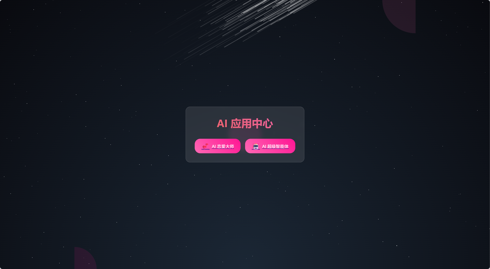

# Spring AI 核心特性应用实战

一个基于 Spring AI 的智能代理系统，集成了多种 AI 能力和工具，支持 RAG（检索增强生成）、MCP（模型上下文协议）等功能。

## 项目架构

### 后端主模块 (zxl-Ai-agent)
- **框架**: Spring Boot 3.4.6 + Java 17
- **AI框架**: Spring AI Alibaba 1.0.0-M6.1
- **协议支持**: Spring AI MCP Client 1.0.0-M6

### 前端模块 (zxl-Ai-agent-fronted)
- **技术栈**: Vue 3 + TypeScript + Vite

### MCP服务模块 (zxl-image-search-mcp)
- **框架**: Spring Boot 3.5.3 + Java 21
- **功能**: 图片搜索 MCP 服务器

## 核心功能

### 1. AI Agent 系统
- **ReActAgent**: 基于 ReAct 模式的推理执行代理
- **ToolCallAgent**: 工具调用代理
- **ZxlManus**: 自定义 Manus 代理实现
- 支持多种 Agent 状态和生命周期管理

### 2. RAG (检索增强生成)
- **文档加载**: 支持 Markdown 文档加载
- **向量存储**: 基于向量的文档检索
- **查询增强**: 上下文查询增强器
- **文本处理**: 自定义 Token 分割器和关键词扩展
- **查询重写**: 智能查询重写器

### 3. 工具集 (Tools)
- **文件操作**: 文件读写、操作工具
- **网页爬取**: WebScrapingTool 支持网页内容提取
- **网页搜索**: WebSearchTool 搜索引擎集成
- **PDF生成**: PDFGenerationTool 基于 iText 的 PDF 生成
- **终端操作**: TerminalOperationTool 系统命令执行
- **资源管理**: ResourceDownloadTool 资源下载工具
- **图片处理**: ImageSplitterTool 图片分割工具

### 4. 聊天记忆系统
- **持久化存储**: FileChatBasedMemory 基于文件的聊天记忆
- **切面支持**: ChatMemoryAspect 聊天记忆切面
- **注解支持**: @RecordChat 注解实现聊天记录

### 5. Advisor 增强器
- **日志增强**: MyLoggerAdviser 日志记录
- **重读增强**: ReReadingAdvisor 重复读取增强
- **RAG增强**: LoveAppRagCustomAdvisorFactory 恋爱咨询专用 RAG 增强

## 技术栈

### 核心依赖
```xml
- Spring Boot Starter Web
- Spring AI Alibaba Starter
- Spring AI MCP Client
- Lombok
- Spring AOP
```

### 文档处理
```xml
- Spring AI Markdown Document Reader
- iText Core (PDF处理)
- Jsoup (网页爬取)
```

### 工具库
```xml
- Hutool All
- JSON Schema Generator (结构化输出)
- Kryo (序列化)
- Knife4j (API文档)
```

## 快速开始

### 环境要求
- JDK 17+ (主模块)
- JDK 21+ (MCP模块)
- Maven 3.6+
- Node.js 16+ (前端)

### 后端启动

1. **配置环境变量**
```bash
# 配置 AI 模型 API Key (根据使用的模型配置)
export AI_API_KEY=your_api_key
```

2. **启动主应用**
```bash
cd zxl-Ai-agent
./mvnw spring-boot:run
# 或使用 Maven
mvn spring-boot:run
```

应用将在 `http://localhost:8123/api` 启动

3. **启动 MCP 图片搜索服务**
```bash
cd zxl-image-search-mcp
./mvnw spring-boot:run
```

服务将在 `http://localhost:8127` 启动

### 前端启动

```bash
cd zxl-Ai-agent-fronted
npm install
npm run dev
```

## 配置说明

### 主应用配置 (application.yml)
```yaml
spring:
  ai:
    mcp:
      client:
        sse:
          connections:
            server1:
              url: http://localhost:8127  # MCP服务器地址
server:
  port: 8123
  servlet:
    context-path: /api
```

### 配置文件
- `application.yml` - 主配置
- `application-local.yml` - 本地环境配置
- `mcp-servers.json` - MCP 服务器配置（可选）

## API 文档

项目使用 Knife4j 提供 API 文档，启动后访问：
- Swagger UI: `http://localhost:8123/api/swagger-ui.html`
- Knife4j UI: `http://localhost:8123/api/doc.html`

## 应用场景

### 1. 恋爱咨询助手 (LoveApp)
基于 RAG 的恋爱问题咨询服务，集成：
- 单身篇、恋爱篇、已婚篇常见问题库
- 向量检索增强
- 上下文感知对话

### 2. 通用 AI 助手
- 支持工具调用的智能对话
- 文件操作和代码执行
- 网页搜索和内容提取
- PDF 文档生成

### 3. 图片搜索服务
通过 MCP 协议提供图片搜索能力

## 项目结构

```
zxl-Ai-agent/
├── src/main/java/com/zxl/zxlaiagent/
│   ├── advisor/          # 增强器
│   ├── agent/            # Agent实现
│   ├── annotation/       # 自定义注解
│   ├── app/              # 应用层
│   ├── chatmemory/       # 聊天记忆
│   ├── config/           # 配置类
│   ├── controller/       # 控制器
│   ├── constant/         # 常量定义
│   ├── rag/              # RAG相关
│   └── tools/            # 工具集
├── src/main/resources/
│   ├── document/         # 文档库
│   └── application.yml   # 配置文件
├── zxl-Ai-agent-fronted/ # 前端项目
└── zxl-image-search-mcp/ # MCP服务
```

## 开发指南

### 添加新工具
1. 在 `tools` 包下创建工具类
2. 使用 `@Tool` 注解标记工具方法
3. 在 `ToolRegistration` 中注册工具

### 添加新 Agent
1. 继承 `BaseAgent` 或实现 `Agent` 接口
2. 实现 `execute` 方法定义执行逻辑
3. 在应用中注入并使用

### 扩展 RAG 能力
1. 在 `rag/loader` 下添加文档加载器
2. 在 `rag/transformer` 下添加文档转换器
3. 配置向量存储和检索器

## 构建与部署

### Maven 打包
```bash
mvn clean package -DskipTests
```

### Docker 部署
项目包含 Dockerfile，可使用以下命令构建镜像：
```bash
docker build -t zxl-ai-agent .
docker run -p 8123:8123 zxl-ai-agent
```

## 当前效果



## 许可证

本项目为个人学习研究项目。

