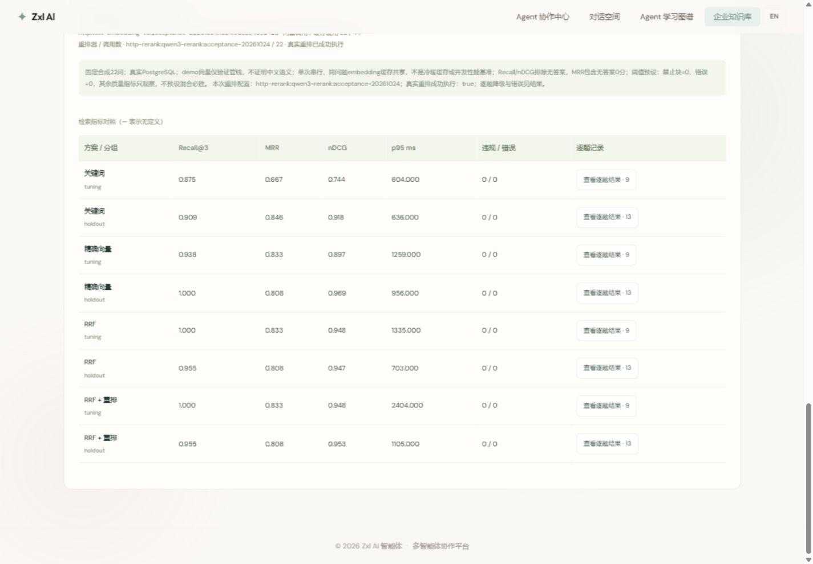

# 第十三课截图验收（2026-10-24）

本批实际操作本机前端5174、教学服务18132及真实PostgreSQL。截图为每次操作后的视口截图；全页截图不可用，未以旧图替代。逐项记录见下表，[图片画廊](gallery.html)可连续查看。截图证明本次状态，不保证任意操作组合永不出错。

## 验收结论与范围

- 后端26套共138项回归通过，失败/错误/跳过均0；其中本课34项专项包含真实PG、共享预算、删除竞态与HTTP协议。前端13项知识库测试、31项图谱测试通过，生产构建成功。
- 检索：三种模式、词汇补充、重排、TopK/候选数/预算、来源展开关闭、清空、成功零命中、100ms超时、恢复与真实重排降级。
- 评测：初始化/刷新、真实与演示模式、调参/留出/全部、TopK与批次预算、运行/导出、8组逐题打开关闭、排名展开收起。未逐一组合所有选项。
- 图谱：95节点134关系28课结构有效；本课相关6个新/变更知识节点、1跳/2跳/全图、2D/3D、筛选/关系/搜索、中英文、阅读卡移动/复位与复制路径已查看。个人掌握保持0/28；并非本批逐一点开95个节点。
- 390宽移动视口与桌面视口、中文/英文均查看；浏览器错误日志为空。69/70为共享页中间状态，后续受用户操作影响，最终以独立验收页72–79为准；14为滚动中间帧，来源定位以18为准。

## 真实模型证据

[真实22题JSON](real-evaluation.json) / [CSV](real-evaluation.csv)，[确定性演示JSON](demo-evaluation.json) / [CSV](demo-evaluation.csv)。真实批次66474ms，22次Embedding、44次缓存命中、22次HTTP重排，8组禁止候选/错误均0。纯向量在这份合成留出集Recall与nDCG最高，不能推出混合必胜或生产质量已验收。52是另一单次查询真实HTTP重排超时后显式回退，不属于22题报告。

## 操作截图索引

| 截图 | 观察 |
| --- | --- |
| [01-lab-entry](01-lab-entry.jpg) | 快捷入口定位实验室，当前浏览器视口；全页截图不可用，采用逐操作视口截图 |
| [02-keyword-mode](02-keyword-mode.jpg) | 选择关键词子串，原结果清空 |
| [03-keyword-results](03-keyword-results.jpg) | 关键词查询有效VPN文档，显示通道名次与来源 |
| [04-inspect-source](04-inspect-source.jpg) | 候选原文校验当前版本与chunk后展开 |
| [05-close-source](05-close-source.jpg) | 关闭证据原文保留检索结果 |
| [06-vector-mode](06-vector-mode.jpg) | 切换向量模式立即清空旧结果 |
| [07-vector-results](07-vector-results.jpg) | 真实1024D向量通道结果，名次/距离/耗时 |
| [08-hybrid-mode](08-hybrid-mode.jpg) | 切换RRF混合清空旧结果 |
| [09-hybrid-results](09-hybrid-results.jpg) | 两路结果RRF融合，候选显示两路名次 |
| [10-enable-rewrite](10-enable-rewrite.jpg) | 打开一次词汇补充，保留原问题 |
| [11-enable-rerank](11-enable-rerank.jpg) | 打开配置的真实HTTP重排 |
| [12-topk-five](12-topk-five.jpg) | TopK5，用于核对有效候选不足 |
| [13-rewrite-http-rerank](13-rewrite-http-rerank.jpg) | 原问题与补充查询并列，真实qwen3重排；有效片段不足5明确显示 |
| [14-source-visible](14-source-visible.jpg) | 点击来源后自动定位原文窗口，版本校验通过 |
| [15-source-closed](15-source-closed.jpg) | 关闭原文后保留候选与其分数 |
| [16-desktop-lab](16-desktop-lab.jpg) | 1440px响应式布局，桌面双列检索 |
| [17-final-runtime-rerank](17-final-runtime-rerank.jpg) | 最新worker版本再校验的服务，真实重排成功 |
| [18-source-immediate](18-source-immediate.jpg) | 原文即时定位进入视口，替代平滑滚动中间截图14 |
| [19-close-source-final](19-close-source-final.jpg) | 关闭即时定位原文 |
| [20-rewrite-control](20-rewrite-control.jpg) | 仅词汇补充开关启用，旧结果清空 |
| [21-controls-disabled](21-controls-disabled.jpg) | 关闭重排和改写，恢复基础检索 |
| [22-candidates-5](22-candidates-5.jpg) | 每路候选上限=5 |
| [22-candidates-10](22-candidates-10.jpg) | 每路候选上限=10 |
| [22-candidates-20](22-candidates-20.jpg) | 每路候选上限=20 |
| [23-topk-1](23-topk-1.jpg) | TopK=1 |
| [23-topk-3](23-topk-3.jpg) | TopK=3 |
| [23-topk-5](23-topk-5.jpg) | TopK=5 |
| [24-success-zero](24-success-zero.jpg) | 关键词查询成功但无当前命中，与服务错误区别 |
| [25-empty-disabled](25-empty-disabled.jpg) | 空问题禁用运行并清除旧结果 |
| [26-budget-1000](26-budget-1000.jpg) | 选择检索共享预算1000ms |
| [26-budget-5000](26-budget-5000.jpg) | 选择检索共享预算5000ms |
| [26-budget-10000](26-budget-10000.jpg) | 选择检索共享预算10000ms |
| [26-budget-100](26-budget-100.jpg) | 选择检索共享预算100ms |
| [27-deadline-error](27-deadline-error.jpg) | 100ms预算不足显示检索错误，不伪装零命中 |
| [28-recovered-hybrid](28-recovered-hybrid.jpg) | 预算错误后10秒恢复混合真实重排，结果可重新使用 |
| [29-clear-results](29-clear-results.jpg) | 清空候选和来源，保留查询选项 |
| [30-evaluation-entry](30-evaluation-entry.jpg) | 固定22问，9调参/13留出，模型快照独立 |
| [31-refresh-evaluation](31-refresh-evaluation.jpg) | 从真实PG刷新固定集准备状态 |
| [32-real-mode](32-real-mode.jpg) | 明确选择真实Embedding，提示合成资料发送与实际调用 |
| [33-real-fixture-ready](33-real-fixture-ready.jpg) | 真实Embedding合成资料已发布，独立租户快照准备完成 |
| [34-split-tuning](34-split-tuning.jpg) | 评测问题分组=tuning |
| [34-split-holdout](34-split-holdout.jpg) | 评测问题分组=holdout |
| [34-split-all](34-split-all.jpg) | 评测问题分组=all |
| [35-eval-k-1](35-eval-k-1.jpg) | 评测K=1 |
| [35-eval-k-5](35-eval-k-5.jpg) | 评测K=5 |
| [35-eval-k-3](35-eval-k-3.jpg) | 评测K=3 |
| [36-eval-budget-30000](36-eval-budget-30000.jpg) | 整轮预算=30000ms |
| [36-eval-budget-60000](36-eval-budget-60000.jpg) | 整轮预算=60000ms |
| [36-eval-budget-120000](36-eval-budget-120000.jpg) | 整轮预算=120000ms |
| [37-evaluation-running](37-evaluation-running.jpg) | 真实22问四策略评测运行中，选项禁用防重复请求 |
| [38-real-evaluation-complete](38-real-evaluation-complete.jpg) | 真实22问完整66474ms；22embedding/44cache/22HTTP重排；8组违规错误0 |
| [39-export-report](39-export-report.jpg) | 点击导出JSON，保存包含固定snapshot/qrels/逐题排名与耗时的真实报告 |
| [40-real-comparison-table](40-real-comparison-table.jpg) | 真实四方案调参/留出全部指标表，保留向量优于RRF的结果 |
| [41-query-group-0](41-query-group-0.jpg) | 打开第1个方案/分组逐题结果，对应表格行 |
| [42-query-close-0](42-query-close-0.jpg) | 关闭第1组逐题窗口，表格仍可操作 |
| [41-query-group-1](41-query-group-1.jpg) | 打开第2个方案/分组逐题结果，对应表格行 |
| [42-query-close-1](42-query-close-1.jpg) | 关闭第2组逐题窗口，表格仍可操作 |
| [41-query-group-2](41-query-group-2.jpg) | 打开第3个方案/分组逐题结果，对应表格行 |
| [42-query-close-2](42-query-close-2.jpg) | 关闭第3组逐题窗口，表格仍可操作 |
| [41-query-group-3](41-query-group-3.jpg) | 打开第4个方案/分组逐题结果，对应表格行 |
| [42-query-close-3](42-query-close-3.jpg) | 关闭第4组逐题窗口，表格仍可操作 |
| [41-query-group-4](41-query-group-4.jpg) | 打开第5个方案/分组逐题结果，对应表格行 |
| [42-query-close-4](42-query-close-4.jpg) | 关闭第5组逐题窗口，表格仍可操作 |
| [41-query-group-5](41-query-group-5.jpg) | 打开第6个方案/分组逐题结果，对应表格行 |
| [42-query-close-5](42-query-close-5.jpg) | 关闭第6组逐题窗口，表格仍可操作 |
| [41-query-group-6](41-query-group-6.jpg) | 打开第7个方案/分组逐题结果，对应表格行 |
| [42-query-close-6](42-query-close-6.jpg) | 关闭第7组逐题窗口，表格仍可操作 |
| [41-query-group-7](41-query-group-7.jpg) | 打开第8个方案/分组逐题结果，对应表格行 |
| [42-query-close-7](42-query-close-7.jpg) | 关闭第8组逐题窗口，表格仍可操作 |
| [46-demo-fixture](46-demo-fixture.jpg) | 显式准备演示向量固定资料，仍为真实PG；不覆盖业务资料 |
| [47-demo-tuning-running](47-demo-tuning-running.jpg) | 演示调参集运行，真实评测已导出独立保留 |
| [48-demo-tuning-complete](48-demo-tuning-complete.jpg) | 演示9问24386ms：9embedding18cache9规则重排，不称语义模型 |
| [49-query-ranking-expanded](49-query-ranking-expanded.jpg) | 逐题候选稳定ID展开 |
| [50-query-ranking-collapsed](50-query-ranking-collapsed.jpg) | 逐题候选身份收起 |
| [51-english-evaluation](51-english-evaluation.jpg) | 英文评测结果及合成集边界，数据未变 |
| [52-english-retrieval-fallback](52-english-retrieval-fallback.jpg) | 真实HTTP重排本次超时，约7.2秒后显式fallback-rrf，保留关键词证据，英文页面区分降级 |
| [53-return-chinese](53-return-chinese.jpg) | 恢复中文，降级结果与元数据保留 |
| [54-mobile-lab](54-mobile-lab.jpg) | 390px实验室单列布局，页面横向无溢出 |
| [55-mobile-evaluation](55-mobile-evaluation.jpg) | 390px评测控件与指标表，表格局部滚动 |
| [56-graph-lesson13](56-graph-lesson13.jpg) | 图谱第13课completed，个人状态仍未开始 |
| [57-graph-one](57-graph-one.jpg) | 第13课切换1跳，保持选中阅读及星点 |
| [57-graph-two](57-graph-two.jpg) | 第13课切换2跳，保持选中阅读及星点 |
| [57-graph-all](57-graph-all.jpg) | 第13课切换全图，保持选中阅读及星点 |
| [57-graph-2d](57-graph-2d.jpg) | 第13课切换2D，保持选中阅读及星点 |
| [57-graph-3d](57-graph-3d.jpg) | 二维返回三维，保持第13课选中与阅读 |
| [58-graph-lesson14](58-graph-lesson14.jpg) | 第14课完整内容与项目待实现状态 |
| [59-graph-2d-stable](59-graph-2d-stable.jpg) | 第14课切2D后阅读标题保留 |
| [60-graph-3d-stable](60-graph-3d-stable.jpg) | 2D返回3D，读取第14课阅读标题保留 |
| [61-node-lesson14-pack](61-node-lesson14-pack.jpg) | 点击节点与对应阅读标题一致：第十四课完整学习任务 |
| [61-node-citation-support](61-node-citation-support.jpg) | 点击节点与对应阅读标题一致：引用有效性与结论支持性 |
| [61-node-confirmed-memory](61-node-confirmed-memory.jpg) | 点击节点与对应阅读标题一致：确认事实与记忆生命周期 |
| [61-node-retrieval-source](61-node-retrieval-source.jpg) | 点击节点与对应阅读标题一致：检索源码 |
| [61-node-lesson13-evidence](61-node-lesson13-evidence.jpg) | 点击节点与对应阅读标题一致：第十三课实现与证据边界 |
| [61-node-lesson13-pack](61-node-lesson13-pack.jpg) | 点击节点与对应阅读标题一致：第十三课完整学习任务 |
| [62-filter-stage](62-filter-stage.jpg) | 上下文与知识能力阶段筛选 |
| [63-filter-lessons](63-filter-lessons.jpg) | 课程类型筛选，显示11至14课 |
| [64-filter-relations](64-filter-relations.jpg) | 先修有向关系筛选，与阶段课程对应 |
| [65-filter-reset](65-filter-reset.jpg) | 清除组合筛选恢复95节点134关系 |
| [66-graph-search](66-graph-search.jpg) | 搜索长期记忆，相关课程和概念可阅读 |
| [67-graph-english](67-graph-english.jpg) | 第13课英文实现与证据、工程状态和双语关系 |
| [68-graph-chinese](68-graph-chinese.jpg) | 返回中文第14课；个人0/28保持不变 |
| [69-reader-move](69-reader-move.jpg) | 方向键移动第14课阅读窗，可复位 |
| [70-reader-reset](70-reader-reset.jpg) | 阅读窗回到所选星点旁 |
| [72-isolated-lesson14](72-isolated-lesson14.jpg) | 独立后台标签页第14课，完整任务路径与内容 |
| [73-isolated-copy14](73-isolated-copy14.jpg) | 第14课路径复制成功，独立窗口避免外部状态变化 |
| [74-isolated-reader-move](74-isolated-reader-move.jpg) | 独立窗口方向键移动，课程保持14 |
| [75-isolated-reader-reset](75-isolated-reader-reset.jpg) | 阅读窗复位后仍保持第14课 |
| [76-isolated-2d](76-isolated-2d.jpg) | 第14课二维阅读与节点显示 |
| [77-isolated-3d](77-isolated-3d.jpg) | 独立窗口二维返回三维保持阅读 |
| [78-isolated-english14](78-isolated-english14.jpg) | 第14课任务与知识关系双语切换 |
| [79-isolated-chinese14](79-isolated-chinese14.jpg) | 中文恢复，工程仍待实现，个人0/28 |
