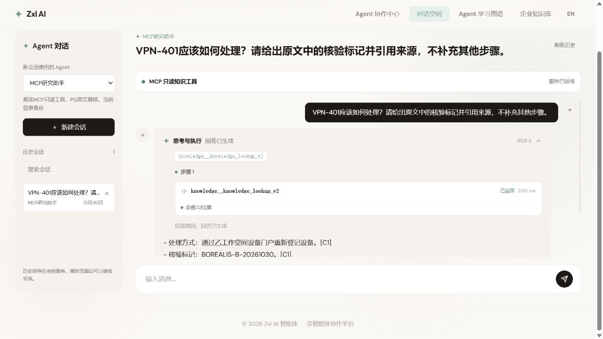

# 第十七课：工作空间、真实研究与跨标签证据（2026-10-30）

本批仍为进行中。实际按钮/状态记录见 [observations.json](observations.json)，明确选择的后端范围见 [backend-tests.json](backend-tests.json)。

| 操作 | 实际结果 | 截图 |
| --- | --- | --- |
| 乙登录读取历史 | 0 条，没有甲会话 | [01](01-b-history-isolated.jpg) |
| 乙打开知识库 | 0 资料，没有甲文档；实际 PG/HTTP 1024D | [02](02-b-empty-knowledge.jpg) |
| 乙导入同文档 ID | 发布独立 v1、2 分块与 b006b42… 修订 | [03](03-b-document-published.jpg) |
| MCP 混合检索 | 只返回乙设备重新登记及 BOREALIS 标记 | [04](04-b-hybrid-own-source.jpg) |
| 重新读取当前原文 | 返回乙修订与 UTF-16 19–115 | [05](05-b-current-source.jpg) |
| 模型驱动研究 | 工具 2102ms 成功，结论引用乙 C1、L3–5 | [06](06-b-real-research-answer.jpg) |
| 共享连接切回甲 | 不重新发现，仍返回甲 AURORA 与重新登录 | [07](07-a-shared-connection-own-source.jpg) |
| 查询中另一标签退出 | 原标签关闭私有内容并显示匿名表单 | [08](08-cross-tab-logout-closes-private.jpg) |
| 另一标签登录乙 | 原标签自动加载乙身份、1 条乙会话；甲旧结果未回流 | [09](09-cross-tab-login-b-refresh.jpg) |

研究成功页面：

## 自动化与真实调用的边界

- 明确选择的 9 类 42 项后端测试，0 失败/错误/跳过，包含真实 PG 和 SDK SSE；不是全仓库全部测试。
- 身份前端 17 项、知识/工具 50 项通过；图谱 34 项通过。最终有界内存串行生产构建通过，保留已有 3D chunk 警告。
- 真实 HTTP Embedding 为 text-embedding-v3 / 1024D；生成模型为 qwen-plus。知识问答 judge 也是 qwen-plus，规则重排明确为 rule，没有宣称独立 judge 或模型重排通过。
- 先保留甲首次知识问答失败与研究超时，再用失败用例复现并修复首次发现预算缩短共享连接上限；不能推断所有原失败原因相同，也未自动重试单次票据。
- 仅一个可控浏览器 profile，两个共享 Cookie 标签与顺序账号切换，不是两个独立 profile 的并发身份验收。

## 实际故障与未验收项

主应用第一次重启遇 Windows 原生内存不足；只限制本轮自有验收进程堆内存后启动成功。构建同样先因原生内存不足失败，停止本轮自有 Java 服务后串行构建通过；没有关闭用户其他应用。

图谱筛选及第十七课更新文字已在页面读到，但随后图谱标签发生 DOM/CDP 响应超时。另一个业务标签仍可响应；它打开图谱并切到二维后又在取证时超时，未得到有效的新图谱截图，因此本批**不能标为图谱全部按钮与视图切换验收通过**。此前保存的个人进度完整备份位于忽略的 `target/lesson17-progress-before-20261030.json`，未改掌握状态/笔记；恢复与再次导出深比较仍须在浏览器恢复后执行，不能冒称已经完成。

SQL 同授权事务与正式 Skill 此后正在实现/回归，不由上面早先运行中的业务截图证明已经验收；后续批次必须另行重启并取证。多 Agent、旧历史受控迁移及独立浏览器配置验收继续列为未完成。第十八课[完整任务](../../learning/18-prompt-injection-and-runtime-isolation.md)已发布、工程仍待实施。
