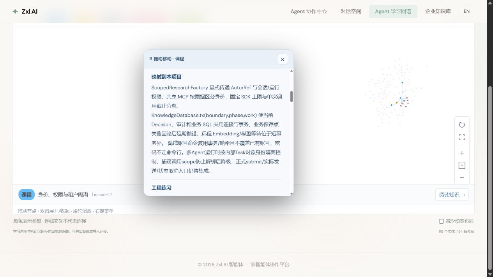

# 账号与多 Agent 运行边界知识卡复检

实际 IAB 浏览器打开第十七课，先导出当前 profile 完整备份至忽略的 target，再操作；没有套用其他日期或其他 profile 的旧备份。

| 操作 | 实际结果与截图 |
| --- | --- |
| 打开所选知识、阅读项目映射 | 新版离线账号/内部Task身份/未集成边界在AX中存在；[01](01-runtime-learning.png)仅显示段落前半，不作为全段可读证明 |
| 3D切到2D | 二维视图响应并保留阅读卡，[02](02-two-d.png) |
| 切英文 | 英文内容与新导读路径已核对，[03](03-english.png) |
| 切回中文、恢复并再次导出 | 第一轮深比较相等，[04](04-progress-restored.png) |
| 滚动核对段落 | [05](05-acceptance-history.png)为历史验收段落，不能冒充新增正文；[06](06-new-knowledge.png)正文部分被视口裁切 |
| 调整外层页面滚动 | [07](07-new-knowledge-readable.png)完整可读新增账号与运行边界段落 |
| 最终恢复个人数据 | 滚动新增了lesson-17阅读位置，最后导出先明确发现不相等，重新恢复本轮初始备份再导出，parsed JSON深比较相等；未自动标已掌握 |

本轮19项运行时测试、5项账号专项/6项相关回归、34项图谱测试和构建是不同层的证据。截图验证课程内容和视图，不能替代正式多Agent业务或新账号隐藏控制台交互验收。没有本批真实多Agent模型调用；正式多Agent接线仍未完成。截图保留真实布局，未承诺所有节点在阅读卡遮挡下均可见。
