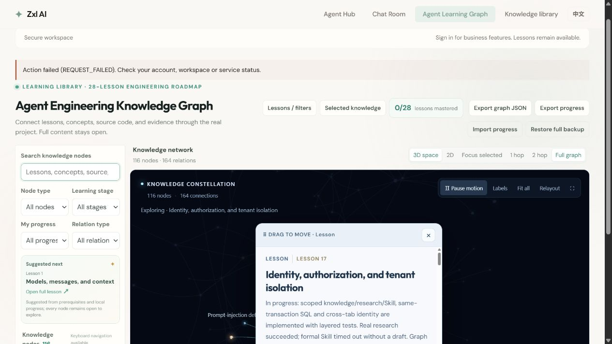

# 第十七课图谱复检：2026-11-06

本次在新建 IAB 浏览器 profile 实际操作，初始掌握状态 0/28。前端为当前工作区 Vite 5174；私有主服务未启动，因此页顶身份请求显示 REQUEST_FAILED，公开课程仍可读。**不是 10 月 30 日原挂起 profile，未证明旧故障根因或修复。** 未修改生产代码。

截图中的 `Action failed (REQUEST_FAILED)` 是当时身份主服务 8123 未启动所产生的实际错误，未隐藏或修复。本次只证明公开图谱在该错误存在时仍可操作，**不能称整个页面没有错误或身份服务验收通过**。

逐步预期、实际结果与未覆盖范围见 [observations.json](observations.json)。

| 实际操作 | 结果 | 画面 |
| --- | --- | --- |
| 搜索“身份”、打开十七课阅读卡 | 21 节点/15 关系；工程进行中，个人未开始 | [01](01-filter-reader.png) |
| 1 跳 | 活跃筛选下 5 节点/6 关系 | [02](02-one-hop.png) |
| 2 跳后切 2D | 9 节点/11 关系，节点和曲线可见 | [03](03-two-hop-two-d.png) |
| 切英文 | 英文阅读卡及二维图可用 | [04](04-english.png) |
| 回 3D、全图并清空搜索 | 计数恢复为 116 节点/164 关系，操作仍响应；不是所有节点可见性的证明 | [05](05-full-three-d.png) |
| 回中文、恢复本轮初始备份再导出 | 解析后的 JSON 深比较相等 | [06](06-progress-restored.png) |

## 进度保留与截图边界

操作前通过页面导出当前 profile 备份到忽略的 `target/lesson17-graph-current-before-20261106.json`。结束后用该备份恢复，再导出到 `target/lesson17-graph-current-after-20261106.json`，解析后的 `schemaVersion` 与 `records` 完全相等。没有导入 10 月 30 日旧备份，避免覆盖潜在后续用户状态；这仅证明当前新 profile 的恢复一致性，不能证明历史 profile 的进度已恢复。

截图由实际浏览器保存并逐张核对主要状态。一次全图操作后，AX 已显示 116 节点而首个截图仍是上一绘制帧（21 节点）；再次读取画面后才保存 05。临时 02 文件名原为 two-hop，但画面实际为 1 跳，因此公开副本更正为 `02-one-hop.png`，没有将旧帧当成二跳证据。

节点绘制的实际观察：01/02 能看见部分三维星点和关联线；03/04 能看见若干二维彩色节点与曲线，未出现整张截图只剩线条的情况。05 的阅读卡遮挡图中央及较大区域，背景非关联星点也较暗，仅能确认露出区域仍有星点、关联节点和线条，以及总计数已恢复；**不能据此证明 116 个节点全部可见、没有单个节点丢失或不存在视角外/遮挡问题**。本次没有关闭阅读卡后逐节点检查，也没有保存每次点击前后相同视角的完整节点对照。

没有复现旧 DOM/CDP 超时；不能据此归因为内存，也不能声称全部按钮验收通过。全屏、重排、拖动、长时间运行、内存压力及历史原 profile 尚未覆盖。页面阅读卡的“图谱卡住待补齐”是此前保留的工程状态，不由本次未复现自动删去。
