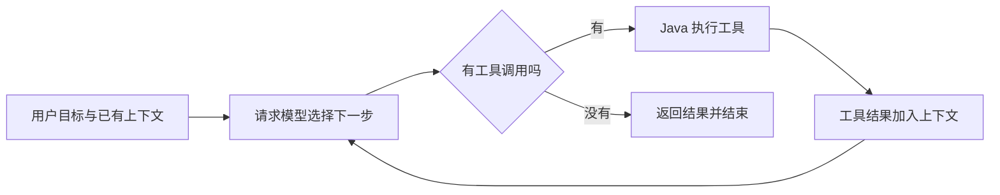

# 第一课：从模型调用走到 Agent

你已经能写 Spring Boot 接口。这节把 AI 模型看作接口背后的一个外部服务，重点理解请求里放什么、结果怎样返回，以及程序如何根据模型结果执行下一步。

本节不要求记住框架的所有类名。完成后，应能沿着当前项目代码讲清一次普通聊天和一次工具调用。

## 1. 模型、框架、Agent 分别是什么

| 名词 | 用熟悉的后端开发语言解释 | 本项目里的对应物 |
| --- | --- | --- |
| 大模型 LLM | 接收消息上下文，生成文本或工具调用请求的服务 | DashScope ChatModel |
| ChatClient | 帮应用构造模型请求和获取结果的客户端 | LoveApp、ToolCallAgent 中使用的 ChatClient |
| Prompt | 本次给模型的指令与信息 | 系统提示词、用户消息、历史消息、工具说明 |
| Tool | 应用允许模型请求执行的真实函数 | FileOperationTool.readFile 等 `@Tool` 方法 |
| Context | 模型当前能够读取的输入信息 | messageList、从文件记忆恢复的历史、工具结果 |
| Agent | 根据目标组织模型请求、执行动作、观察结果、继续或结束的程序 | ZxlManus 的执行循环 |

Spring AI 提供模型与工具的对接能力。Agent 的步骤限制、状态、错误处理和任务控制在本项目的应用代码里实现。

## 2. 本次真实实验：为什么相同 chatId 能记住昵称

2026-10-15，通过当前运行的 `/api/ai/love_app/chat/sync` 接口进行了以下演示，使用的是虚构昵称。

| 请求 | 会话 | 输入 | 实际回复 |
| --- | --- | --- | --- |
| 第一轮 | A | 这是一次编程教学演示。请记住我的演示昵称是小林，只回复一句确认。 | 确认，小林。 |
| 第二轮 | A | 在这次演示中，我刚才告诉你的昵称是什么？只回答昵称。 | 小林 |
| 对照轮 | B，新 chatId | 在这次演示中，我刚才告诉你的昵称是什么？只回答昵称；如果不知道就回答不知道。 | 不知道 |

这里发生的是应用保存并重新提交会话上下文。我们没有为这三次请求训练模型，也没有修改模型参数。

LoveApp 的 MessageChatMemoryAdvisor 使用 chatId 找到对应历史；FileChatBasedMemory 从 `chat-memory` 目录的 Kryo 文件读写消息。新会话 B 使用不同文件，因此没有 A 的昵称上下文。

一轮对话的消息可以理解为：

```text
system：你是一位恋爱咨询专家……
user：请记住我的演示昵称是小林……
assistant：确认，小林。
user：我刚才告诉你的昵称是什么？
```

第二轮不只是发送最后一句问题，记忆机制还会把可用历史加入模型请求。历史越多，请求通常也会变大；后续要控制保留范围，而不是无限追加。

## 3. 从当前代码理解一次普通模型调用

打开 [LoveApp](D:/idea_java_project/Agent/zxl-Ai-agent/src/main/java/com/zxl/zxlaiagent/app/LoveApp.java)。同步 doChat 方法的核心结构是：

```java
ChatResponse chatResponse = chatClient.prompt()
        .user(message)
        .advisors(spec -> spec.param(CHAT_MEMORY_CONVERSATION_ID_KEY, chatId)
                .param(CHAT_MEMORY_RETRIEVE_SIZE_KEY, 10))
        .call()
        .chatResponse();
```

- `prompt()`：开始构造本次模型请求。
- `user(message)`：放入当前用户消息。
- `advisors(...)`：为记忆增强器指定会话与检索条数。构造 ChatClient 时已经设置了系统提示词和记忆增强器。
- `call()`：执行同步请求，等待完成。
- `chatResponse()`：取完整响应对象，代码再从中取得文本。

前端恋爱大师实际调用的是流式方法 [doChatByStream](D:/idea_java_project/Agent/zxl-Ai-agent/src/main/java/com/zxl/zxlaiagent/app/LoveApp.java:203)，结尾换成 `.stream().content()`。响应通过 SSE 逐块发送给浏览器。

SSE 负责输送结果，记忆负责准备上下文。普通流式请求中目前没有 `.tools(allTools)` 或 RAG advisor，因此这个页面默认是带会话记忆的聊天。

## 4. Agent 怎样多走一步

假设目标是“读取 learning-note.txt 并总结内容”。模型先看到读文件工具的说明，然后可以提出一个工具调用请求。简化示意：

```json
{
  "name": "readFile",
  "arguments": { "fileName": "learning-note.txt" }
}
```

Java 应用寻找匹配的工具，调用方法取得文件内容，将结果加入消息列表，然后再次请求模型完成总结。模型提出函数名和参数，实际文件读取由应用执行。



项目还用 maxSteps 限制循环次数，并允许终止工具结束任务。停止条件是 Agent 程序的一部分。

工具需要三处配合：

1. 在 Java 方法上定义 `@Tool` 和参数说明。
2. 在 ToolRegistration 中生成 ToolCallback，并加入可用工具集合。
3. 请求模型时通过 `.tools(availableTools)` 提供这些工具定义；模型返回调用后，由工具执行器执行。

仅在提示词中写“你能读取文件”，不会自动创建上述方法、注册工具或取得文件权限。

## 5. 在 ZxlManus 代码里找出循环

按下面顺序阅读，每个文件只关注一个职责：

| 代码 | 当前需要理解的职责 |
| --- | --- |
| [AiController.doChatWithManus](D:/idea_java_project/Agent/zxl-Ai-agent/src/main/java/com/zxl/zxlaiagent/controller/AiController.java:79) | 接到 HTTP 请求后，创建一个 ZxlManus，调用 runStream |
| [ZxlManus 构造方法](D:/idea_java_project/Agent/zxl-Ai-agent/src/main/java/com/zxl/zxlaiagent/agent/ZxlManus.java:14) | 配置提示词、工具、模型客户端和 20 步限制 |
| [BaseAgent.runStream](D:/idea_java_project/Agent/zxl-Ai-agent/src/main/java/com/zxl/zxlaiagent/agent/BaseAgent.java:98) | 管理状态、消息列表、循环和 SSE 返回 |
| [ReActAgent.step](D:/idea_java_project/Agent/zxl-Ai-agent/src/main/java/com/zxl/zxlaiagent/agent/ReActAgent.java:35) | 本轮先 think，再决定是否 act |
| [ToolCallAgent.think](D:/idea_java_project/Agent/zxl-Ai-agent/src/main/java/com/zxl/zxlaiagent/agent/ToolCallAgent.java:59) | 给模型上下文和工具定义，读取模型返回的工具请求 |
| [ToolCallAgent.act](D:/idea_java_project/Agent/zxl-Ai-agent/src/main/java/com/zxl/zxlaiagent/agent/ToolCallAgent.java:111) | 使用 ToolCallingManager 执行工具，把 conversationHistory 回填 messageList |

ReActAgent.step 的关键逻辑是：

```java
boolean shouldAct = think();
if (!shouldAct) {
    this.setState(AgentState.FINISHED);
    return "思考完成 - 无需行动";
}
return act();
```

`think()` 是项目的业务函数名，表示请求模型决定下一步，并不保证我们能读取模型内部完整推理过程。调试时应观察可验证信息：请求的工具名、输入参数、真实返回值、耗时、状态变化。

## 6. 为什么已经有五个 Agent，还要学习单 Agent

MultiAgentConfig 注册了五个角色，它们使用同一个 ChatModel，区别主要是提示词、输入与职责。

当前 ResearchAgent 声明了 `web_search`，但 `processTask()` 最终调用的是 `callLlm()`；它没有在请求中提供搜索工具。因此，对“检索了资料”的判断应该查看真实工具调用记录和返回结果，而不是只看角色名称或回答措辞。

掌握一条完整工具执行循环后，我们才能把真实检索能力接进 ResearchAgent，再讨论多 Agent 之间怎样传递数据、处理依赖和失败。

## 7. 本节练习与完成标准

在浏览器打开恋爱大师，发送一条虚构昵称，然后用同一页面追问昵称。记录页面中的会话 ID；重新进入页面后再次追问，并比较会话 ID 与结果。前端重新挂载页面会生成新 chatId，这也说明“后端保存了记录”和“前端恢复了旧会话”是两个功能。

阅读代码后，用自己的话回答：

1. 为什么同一 chatId 能回忆昵称，换 chatId 后不知道？
2. 模型提出 readFile 调用时，是哪个 Java 组件真正执行工具？
3. 工具结果为什么要重新放回 messageList？
4. Agent 没有执行步数限制，可能出现什么情况？
5. ResearchAgent 提示词写了 web_search，为什么仍不能据此认定它进行了联网搜索？

完成标准：能从 HTTP 请求出发，讲清“准备上下文 → 请求模型 → 判断是否调用工具 → 应用执行工具 → 更新上下文 → 继续或结束”。

下一课：添加一个只读的时间查询工具，注册到合适的工具集合，观察真实函数调用和结果回填。

## 资料

- [Spring AI 工具调用](https://docs.spring.io/spring-ai/reference/api/tools.html)
- [Spring AI 会话记忆](https://docs.spring.io/spring-ai/reference/api/chat-memory.html)
- [ReAct 原始论文](https://arxiv.org/abs/2210.03629)

官方文档可用于概念学习；本项目使用 M6 版本，后续代码练习继续采用仓库当前的 API。
