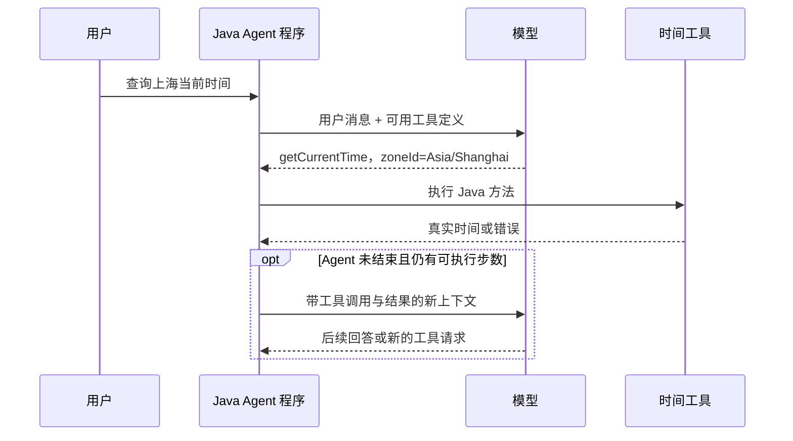

# 第二课：让 Agent 调用一个真实的 Java 工具

适合：已完成第一课，能写 Spring Boot 接口，刚开始学习 Agent 开发。

预计用时：60 分钟。继续按“概念 → 当前代码 → 动手练习 → 观察证据 → 复盘”学习。

本节任务：为 **ZxlManus 超级智能体** 添加一个时间查询工具，输入时区，返回服务器当前时间，并在页面观察完整执行过程。

版本说明：本文保留第二课使用文本返回值的入门示例。第三课已将所有本地工具升级为 `ToolResult<T>`；当前运行代码与结果结构以 [第三课](03-agent-loop-and-results.md) 为准。

当前学习进度（2026-10-16）：你已编写并注册 `CurrentTimeTool`。超级智能体页面已接入实时思考、工具卡片和最终回答，并用真实模型完成了一次上海时间查询。下一步通过页面记录理解调用链，再完成独立变式练习；无需逐行打断点。

## 1. 这节课要学会什么

完成后，你应能：

1. 解释工具定义、工具调用请求和工具执行结果的区别。
2. 用 `@Tool`、`@ToolParam` 定义一个模型可请求调用的 Java 方法。
3. 找到工具注册、传给模型、实际执行、结果回填的四个位置。
4. 从页面的真实执行事件中识别调用参数、执行状态和工具结果。
5. 让错误参数得到明确结果，避免把失败解释成成功。

时间工具只读取系统时钟，没有额外服务凭据。这样可以集中观察工具调用本身。它读取的是后端服务器的时钟，准确性取决于服务器的时钟设置。

## 2. 60 分钟安排

| 时间 | 学习内容 | 这一阶段的产出 |
| --- | --- | --- |
| 0–10 分钟 | 工具定义、调用请求、执行结果 | 能用自己的话解释三者 |
| 10–20 分钟 | 沿当前项目寻找调用链 | 找到下面四个代码位置 |
| 20–40 分钟 | 写时间工具并注册 | 新增工具类，完成注册 |
| 40–55 分钟 | 在超级智能体页面观察一次调用 | 保存工具名、参数、执行状态和结果 |
| 55–60 分钟 | 回答复盘题 | 解释一轮工具调用发生了什么 |

## 3. 先讲概念：模型怎样使用你的 Java 方法

你熟悉的接口调用通常是：调用方知道接口地址和参数，后端执行方法，返回结果。

工具调用则多了一个选择过程：应用把可用工具的说明交给模型，模型根据用户目标决定是否请求调用某个工具，以及使用什么参数；应用负责执行这个请求。

模型请求的是一个被应用注册的工具。它不会因为看到一段提示词，就获得执行任意 Java 方法的能力。

| 概念 | 时间查询例子 | 谁负责 |
| --- | --- | --- |
| 工具定义 Tool Definition | 名字 `getCurrentTime`、功能说明、`zoneId` 参数结构 | Java 应用生成并发送给模型 |
| 工具调用请求 Tool Call | 请求 `getCurrentTime`，参数为 `{"zoneId":"Asia/Shanghai"}` | 模型提出 |
| 工具执行 Tool Execution | 调用 `ZoneId.of`、读取系统时钟 | Java 应用执行 |
| 工具结果 Tool Result | 时区、带偏移量的时间，或明确错误 | Java 方法返回，框架转换后放入上下文 |
| 后续回答 | 根据返回时间组织中文说明 | 模型基于新上下文生成 |

工具的名字、说明和参数结构帮助模型选择并构造调用。应用仍需校验参数、执行方法并回填结果。参见 [Spring AI 官方工具调用文档](https://docs.spring.io/spring-ai/reference/api/tools.html)。

这个 JSON 只是调用请求的简化示意：

```json
{
  "name": "getCurrentTime",
  "arguments": {
    "zoneId": "Asia/Shanghai"
  }
}
```

协议中的完整消息还有调用 ID 等信息；不同模型适配器的外层格式也可能不同。本节在 `AssistantMessage.ToolCall` 中观察框架解析后的 `name()` 和 `arguments()`。



工具结果回填后，只有 Agent 尚未结束且未达到步数限制，才会在下一轮 `think()` 请求模型。`act()` 先执行工具和更新上下文，本身并不完成下一轮模型请求。如果同一轮调用了终止工具，回填后就会结束。

## 4. 再看代码：当前项目的四个连接点

| 顺序 | 代码位置 | 重点看什么 |
| --- | --- | --- |
| 1. 注册 | [ToolRegistration.allTools](../../src/main/java/com/zxl/zxlaiagent/tools/ToolRegistration.java) | `ToolCallbacks.from(...)` 把带注解的方法转换成工具回调 |
| 2. 提供 | [ToolCallAgent.think](../../src/main/java/com/zxl/zxlaiagent/agent/ToolCallAgent.java) 与 [DashScopeAgentStreamer](../../src/main/java/com/zxl/zxlaiagent/agent/stream/DashScopeAgentStreamer.java) | 页面流式入口把 `ToolDefinition` 转为模型工具定义，流式聚合后由 `getToolCalls()` 读取请求 |
| 3. 执行 | 同一文件中的 `act()` | `toolCallingManager.executeToolCalls(...)` 找到并执行对应方法 |
| 4. 回填 | 同一文件中的 `act()` | `setMessageList(toolExecutionResult.conversationHistory())` 更新上下文 |

工具数组通过 [AiController](../../src/main/java/com/zxl/zxlaiagent/controller/AiController.java) 传入 [ZxlManus](../../src/main/java/com/zxl/zxlaiagent/agent/ZxlManus.java)，其父类保存为 `availableTools`。

当前项目使用 Spring AI Alibaba `1.0.0-M6.1`。页面流式入口通过新增的 DashScope 适配器接收模型分片，再由 `ToolCallingManager` 执行工具。原有非流式 `ChatClient` 分支仍使用 `.tools(availableTools)` 和 `withProxyToolCalls(true)`。两个分支共用已注册的工具回调与 `think → act` 循环。

页面观察链路多了一层：模型的 `reasoning_content` → `THINKING_DELTA`，模型回答 → `ANSWER_DELTA`；实际工具回调前后发送 `TOOL_STARTED` 与 `TOOL_COMPLETED` / `TOOL_FAILED`。前端 [AgentExecutionFlow](../../zxl-Ai-agent-fronted/src/components/AgentExecutionFlow.vue) 把这些事件呈现为思考文字和工具卡片。提供方没有返回思考字段时，页面只展示实际阶段和工具事件。

阅读时先回答：如果只写好一个 `@Tool` 方法，忘记放入 `ToolCallbacks.from(...)`，这个 Agent 能看到它吗？

## 5. 动手一：写时间查询方法

在 `src/main/java/com/zxl/zxlaiagent/tools` 下创建 `CurrentTimeTool.java`。

先自己尝试，再对照参考实现：

```java
package com.zxl.zxlaiagent.tools;

import lombok.extern.slf4j.Slf4j;
import org.springframework.ai.tool.annotation.Tool;
import org.springframework.ai.tool.annotation.ToolParam;

import java.time.DateTimeException;
import java.time.ZoneId;
import java.time.ZonedDateTime;
import java.time.format.DateTimeFormatter;

@Slf4j
public class CurrentTimeTool {

    @Tool(description = "查询指定时区的服务器当前时间，需要当前日期或时间时使用")
    public String getCurrentTime(
            @ToolParam(description = "Java 时区 ID，例如 Asia/Shanghai、UTC、America/New_York")
            String zoneId) {
        if (zoneId == null || zoneId.isBlank()) {
            return "ERROR: MISSING_ZONE；请提供时区，例如 Asia/Shanghai";
        }

        try {
            ZoneId zone = ZoneId.of(zoneId);
            ZonedDateTime now = ZonedDateTime.now(zone);
            String time = now.format(DateTimeFormatter.ISO_OFFSET_DATE_TIME);
            log.info("TIME_TOOL_EXECUTED zoneId={} time={}", zone.getId(), time);
            return "zoneId=%s; currentTime=%s".formatted(zone.getId(), time);
        } catch (DateTimeException e) {
            return "ERROR: INVALID_ZONE；请使用有效时区，例如 Asia/Shanghai 或 UTC";
        }
    }
}
```

逐段理解：

- `@Tool`：声明可作为工具的方法；这里默认工具名为方法名 `getCurrentTime`。
- `description`：说明工具用途和适用情况，帮助模型选择工具。
- `@ToolParam`：说明参数含义，帮助模型填入正确的时区 ID。
- `ZoneId.of(...)`：由 Java 校验时区，参数说明不能替代校验。
- `ZonedDateTime.now(zone)`：读取服务器当前时刻，按指定时区表示。
- ISO 格式：保留日期、时间和 UTC 偏移量，避免只返回“上午十点”这种含糊结果。
- 日志标记：需要定位问题时可辅助查阅；本课主要使用页面执行记录。
- `ERROR` 返回：参数错误作为文本结果回填给模型；执行观察器会将这类工具卡片标为错误，但整个任务仍可能由模型解释错误或修正参数后继续。第三课会研究工具状态与任务状态的区别。

类中没有 `@RestController`，因为本节通过工具回调执行方法，不需要为它新建 HTTP 接口。它也没有 `@Component`：这里沿用当前注册器中手动创建工具实例的方式。

## 6. 动手二：把工具接入注册器

打开 `ToolRegistration.allTools()`，做两处修改。

**第一处：** 与其他工具实例放在一起。

```java
CurrentTimeTool currentTimeTool = new CurrentTimeTool();
```

**第二处：** 在现有 `ToolCallbacks.from(...)` 参数列表中加入实例。列表结尾可改为：

```java
imageSplitterTool,
terminateTool,
currentTimeTool
```

保留已有注册逻辑，合并 MCP 工具的代码仍继续工作。工具名应在同一工具集合中保持唯一。

这一步的因果链是：

```text
CurrentTimeTool 实例
→ ToolCallbacks.from 生成回调
→ allTools 数组
→ AiController 创建 ZxlManus 时传入
→ ToolCallAgent 的 availableTools
→ think() 中的流式适配器读取工具定义并发送给模型
```

如果本地后端进程还在使用旧代码，需要重新编译并启动后再观察。启动条件、凭据配置和已知初始化限制见 [项目 README](../../README.md)。

## 7. 动手三：观察一次完整调用

### 7.1 打开页面执行流程

打开 **超级智能体** 页面。发送消息后，“思考与执行”会自动展开，模型实际返回的思考片段持续追加；工具卡片显示名字、状态和耗时，点击“参数与结果”可查看内容。最终回答显示在流程下方，运行结束后流程自动折叠，仍可展开复查。

本课直接用这些记录验收。断点和后端日志作为遇到具体故障时的可选定位手段。

### 7.2 在正确页面发送目标

打开前端的 **超级智能体** 页面，发送：

> 请调用 getCurrentTime 查询 Asia/Shanghai 当前时间，再用一句中文说明工具返回的时间。

这只是用户指令，模型是否按要求调用仍须观察实际卡片。当前 Agent 在模型不再请求工具时结束，并保留最终回答；无需额外要求终止工具。

本节使用超级智能体页面，因为它调用 `/api/ai/manus/chat`，进入 ZxlManus 工具循环。恋爱大师默认流式入口没有传入这个工具集合；多 Agent 的 ResearchAgent 也尚未接入这套工具循环。

### 7.3 看懂三层证据

| 证据 | 从哪里看 | 能证明什么 |
| --- | --- | --- |
| `getCurrentTime` 和 `zoneId=Asia/Shanghai` | 工具卡片的名字与调用参数 | 模型提出了调用请求 |
| “已返回”、实际耗时和真实时间 | 工具卡片的状态与真实返回 | Java 工具回调已执行并返回 |
| 最终中文回答使用相同时间 | 流程下方的回答，与工具结果对照 | 模型使用了回填结果组织回答 |

只看到模型写“我调用了工具”，不能证明工具执行过。卡片由实际工具回调发出的事件驱动，思考文字只来自模型返回的思考字段。如果工具成功后下一轮模型请求失败，页面会保留已完成的工具记录，同时显示任务错误。

本次页面演示已得到 `zoneId=Asia/Shanghai; currentTime=2026-10-16T01:00:58.6909538+08:00`，随后显示对应的中文回答。这个时间用于记录演示，自己操作时应观察新返回值。

代码对应关系：`think()` 保存带调用 ID 的助手消息 → `act()` 执行回调 → `conversationHistory()` 包含工具结果 → 下一轮请求模型 → 回答分片显示在页面。流式分片里的空 ID 不会覆盖先前已收到的有效调用 ID，保证请求、执行和结果可以关联到同一张卡片。

### 7.4 练习一个错误参数

先把查询参数改成 `UTC`，对比返回时间中的偏移量。再发送：“请使用 getCurrentTime 查询时区 Mars/Olympus，保留工具返回的错误信息。”

如果模型实际调用了这个无效时区，工具应返回 `ERROR: INVALID_ZONE`，卡片显示错误，模型可解释错误或要求澄清。模型也可能直接识别无效时区并澄清，此时没有工具调用卡片；记录实际行为即可，不把未调用说成已验证。

## 8. 常见卡点

| 现象 | 排查顺序 |
| --- | --- |
| 模型回答时间，但没有工具卡片 | 查是否注册、后端是否重启、是否进入超级智能体页面、模型是否实际请求了工具 |
| 卡片停在待执行或显示错误 | 展开参数与结果，检查工具名、参数结构和执行阶段的回调集合 |
| 工具已返回，模型仍给出不同时间 | 对比工具结果与最终文本；查看是否重复调用，是否回填了结果 |
| 页面显示模型错误，工具卡片却已返回 | 工具执行与后续模型请求是不同阶段；按错误信息定位后续请求 |
| 有阶段和工具记录，但没有思考文字 | 检查所用模型是否支持并实际返回 `reasoning_content` |
| `Connection reset`，没有任何工具调用请求 | 模型请求可能在工具选择前失败；先处理模型服务连接问题 |
| 后端启动失败 | 按 README 检查编排初始化和 MCP 连接；启动故障与工具方法本身分别排查 |

## 9. 复盘与完成标准

用自己的话回答：

1. 模型看到了工具定义，为什么还需要 `ToolCallingManager`？
2. `@ToolParam` 写清了时区，为什么 Java 还要校验？
3. 工具执行完，为什么还要把结果加入 `messageList`？
4. 只在回答里写“我查询了时间”，能证明 Java 执行了吗？你的证据是什么？
5. Java 返回 `ERROR: INVALID_ZONE`，为什么不能直接认定整个 Agent 已进入 ERROR 状态？

本课完成标准：

- [ ] 能解释定义、调用请求和结果的区别。
- [ ] 完成工具类和注册，并说出四个连接点。
- [ ] 在页面找到一次真实调用的工具名、参数、执行状态和返回结果。
- [ ] 观察有效时区与无效时区的不同返回。
- [ ] 能说明模型思考文字、工具执行事件与最终回答分别来自哪里。

给我反馈时，可以使用下面的格式，填入实际记录：

```text
工具名：
模型传入的参数：
页面执行状态：
工具真实返回：
最终回答是否使用了该结果：
无效时区返回：
仍然不理解的地方：
```

下一课：沿着 `think → act → 下一轮` 阅读单 Agent 循环，理解并完善正常结束、错误、步数限制与输出规则。

## 参考与阅读顺序

- [第一课：模型、上下文与 Agent 循环](01-model-context-and-agent-loop.md)
- [课程地图](README.md)
- [企业级工程实践与面试路线](enterprise-agent-roadmap.md)：本课是第 2 课，完成工具调用闭环后逐步进入可靠性、持久化和业务治理。
- [ai-agent-book 第 2 章](https://github.com/bojieli/ai-agent-book/blob/dbc046eb896ac4e39aa19c7774c8bf49583b89a6/book/chapter2.md)：对照工具请求、工具消息和下一轮模型请求的关系。
- [Spring AI 官方工具调用文档](https://docs.spring.io/spring-ai/reference/api/tools.html)：用于概念参考；本课代码遵循当前仓库的 M6 版本。
