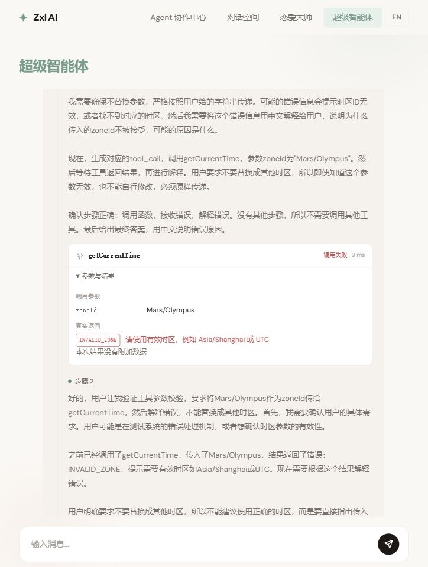
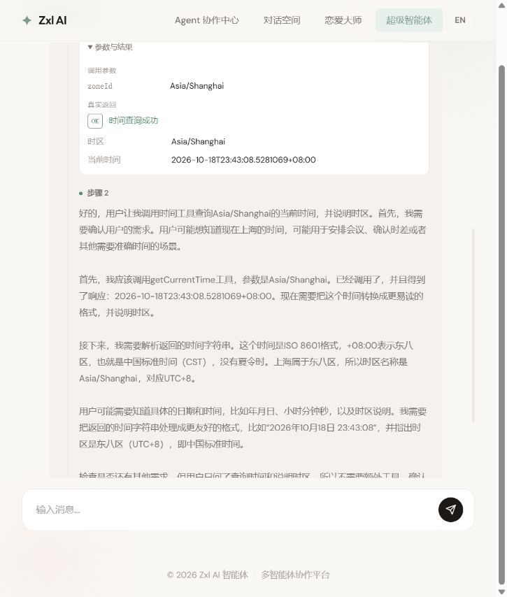
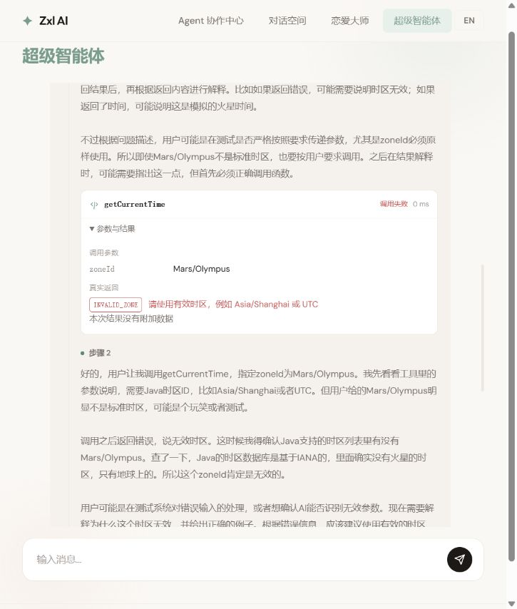
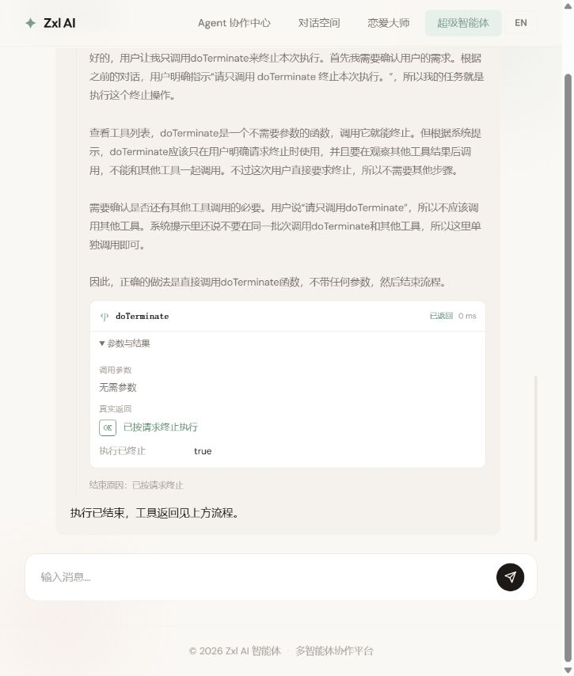
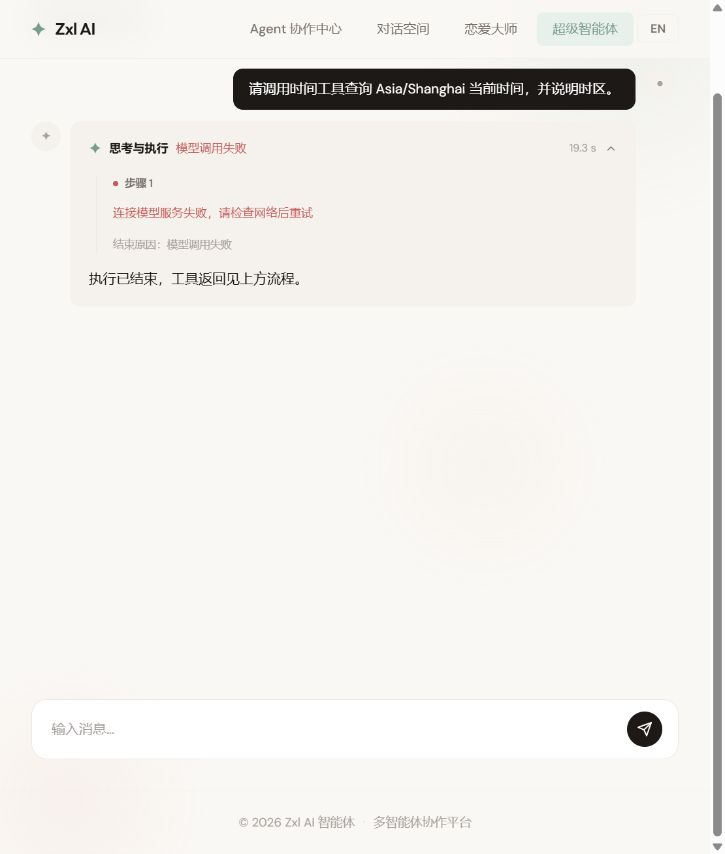

# 第三课工程验收记录

日期：2026-10-18。范围：预算边界、结束原因、所有工具统一结果和前端展示。

## 已完成

- 任务一：1–50 步校验，运行中禁止改预算，双入口一致判断，最后允许的一步完成不误报超限。
- 任务二：记录 ANSWER_READY、STEP_LIMIT、TERMINATED_BY_TOOL、MODEL_ERROR、TOOL_ERROR、EXECUTION_ERROR；补充 TOOL_RETURNED 和 OUTPUT_INTERRUPTED，终态 SSE 携带原因。
- 任务三：9 类本地工具的 10 个方法均返回 ToolResult；MCP 独立适配，保留协议错误与原始 payload；业务失败回填给模型，未处理异常终止。
- 任务四：前端保留实际思考与回答增量，显示结束原因、参数、结果状态码、说明与数据，支持中英文，保留失败前已完成的记录。

## 本地自动检查

```text
mvn -q -Dtest=BaseAgentBudgetTest,AgentOutcomeTest,UnifiedToolContractTest,McpResultContractTest,ToolExecutionLocalTest test
```

| 检查类 | 用例数 | 覆盖 |
| --- | --- | --- |
| BaseAgentBudgetTest | 21 | 合法/非法预算、状态保持、双入口边界与错误停止 |
| AgentOutcomeTest | 11 | 正常回答、预算、终止、模型故障、真实注解工具异常、业务失败后解释、直接返回和输出中断 |
| UnifiedToolContractTest | 5 | 所有本地方法契约、时间参数、实际回调 JSON、文件读写和缺失参数 |
| McpResultContractTest | 4 | MCP 错误标记、原始 payload、非法契约和长结果展示 |
| ToolExecutionLocalTest | 7 | 本地 HTTP 搜索/抓取/下载，实际 PDF、图片所有行和受控命令退出码 |
| 合计 | 48 | 失败 0，错误 0，跳过 0 |

前端 `npm run build` 通过，包含 TypeScript 类型检查和 Vite 生产构建。

## 真实模型与页面

模型：本地配置的 qwen-plus，DashScope 流式兼容接口。

| 场景 | 实际记录 |
| --- | --- |
| 上海当前时间 | getCurrentTime 返回 success=true、OK、时区和真实时间；模型两步完成回答，页面显示“回答已生成” |
| 无效时区 Mars/Olympus | 实际请求该参数；工具卡片显示 INVALID_ZONE，模型下一轮解释错误，整体 ANSWER_READY |
| 明确请求 doTerminate | 实际执行终止工具；整体 TERMINATED_BY_TOOL，页面显示“已按请求终止” |
| 中英文切换 | 结束原因、工具状态和按钮文案切换正常，恢复为中文 |




## 独立审查中补齐的问题

1. CancellationException 原样透传，避免输出连接中断被提前标成模型或工具失败。
2. M6 工具异常处理器设置 alwaysThrow(true)，防止注解方法抛出的异常被转换成普通文本并继续正常结束。
3. 长结果仅裁剪展示数据，再重新序列化，保证 success/code/message/data 仍可解析；模型上下文保留完整结果。

## 2026-10-18 晚间复测

应用户要求重新执行上述 5 个检查类：48 个用例全部通过，失败 0、错误 0、跳过 0。报告更新时间为 23:41，前端类型检查与生产构建也通过。

在运行中的前端页面通过 qwen-plus 再次验证，记录如下。耗时为本次页面实际显示值，不代表性能基准或服务保证。

| 场景 | 本次观测 | 结论 |
| --- | --- | --- |
| 首次查询上海时间 | 19.3 秒后连接模型服务失败；后端根因链为 SocketException: Connection reset，页面显示“模型调用失败”，未显示工具成功记录 | 错误展示符合预期；本次模型连接确实失败 |
| 手动重试同一问题 | 7.8 秒完成两步执行，getCurrentTime 耗时 12 毫秒，返回 2026-10-18T23:43:08.5281069+08:00 | 正常调用与回答通过 |
| 时区原样传 Mars/Olympus | 10.6 秒完成；卡片显示“调用失败”和 INVALID_ZONE，下一步模型说明无效时区，整体显示“回答已生成” | 业务失败与回答完成得到区分 |
| 仅调用 doTerminate | 2.8 秒完成；真实返回 terminated=true，结束原因显示“已按请求终止” | 主动终止通过 |

连接错误之后仅通过页面手动重试恢复成功，未修改网络配置或应用代码；尚不能从单次连接重置确定网络链路的最终原因，也未将恢复归因于某项代码修复。真实模型链路仍有外部网络依赖。









## 覆盖边界

- 本地 HTTP 服务验证了搜索、抓取和下载的实际 I/O；未把外部 SearchAPI 的账户、额度及可用性算成已经验收。
- MCP 使用本地受控协议返回验证适配；未声称所有远程 MCP 服务均在线。
- 模型与工具故障使用受控本地响应，避免依赖不稳定外部故障；预算页面演示见第三课之前保存的记录。
- 浏览器停止接收不等同于取消所有在途工具。完整取消、并发配额、任务持久化与权限治理分别在后续课程实现。
- 本记录证明第三课工程任务的覆盖范围；个人掌握程度通过解释调用链、独立变式和面试复盘继续确认。

下一课：[第四课：会话、历史存储与上下文恢复](04-conversations-and-memory.md)。
