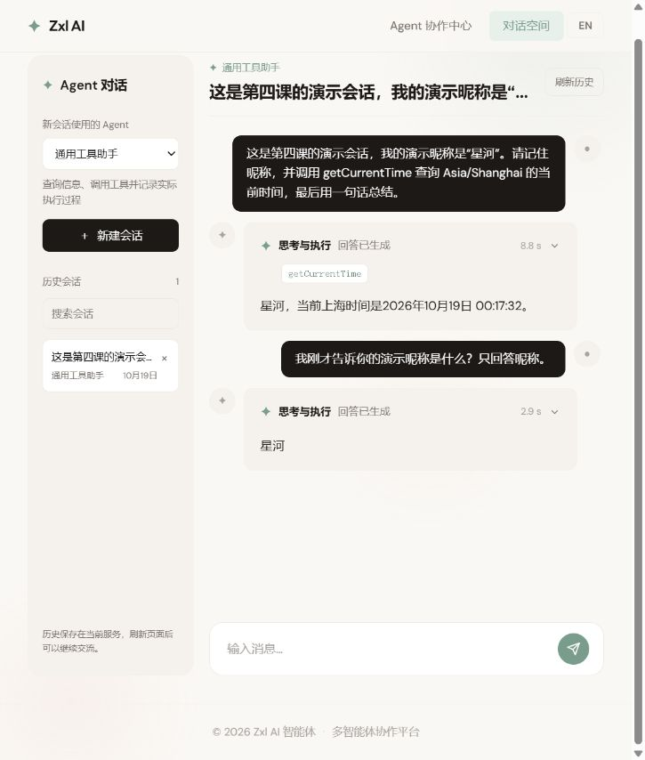
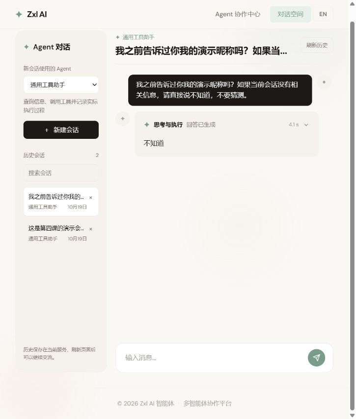
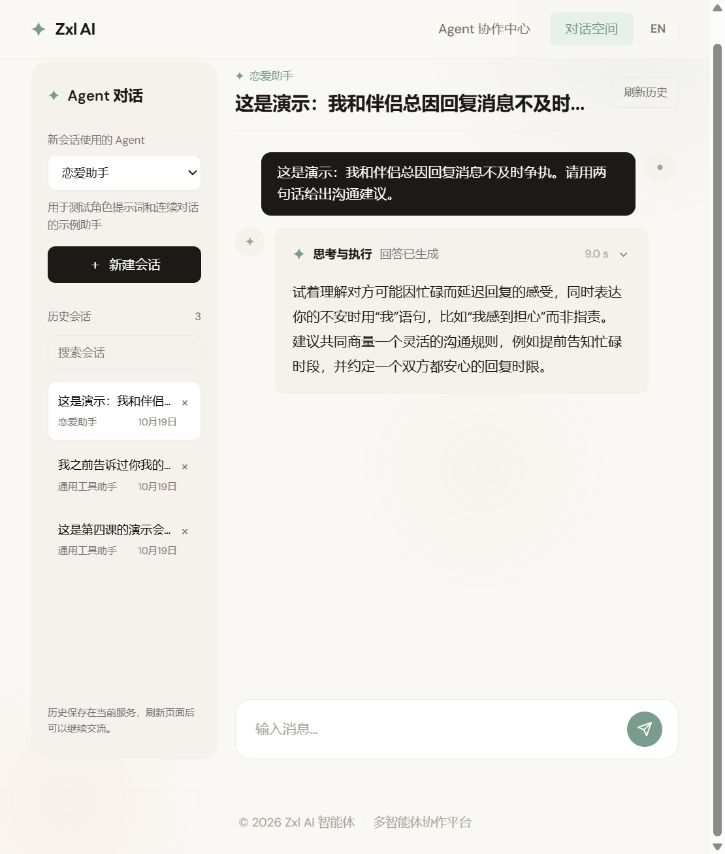
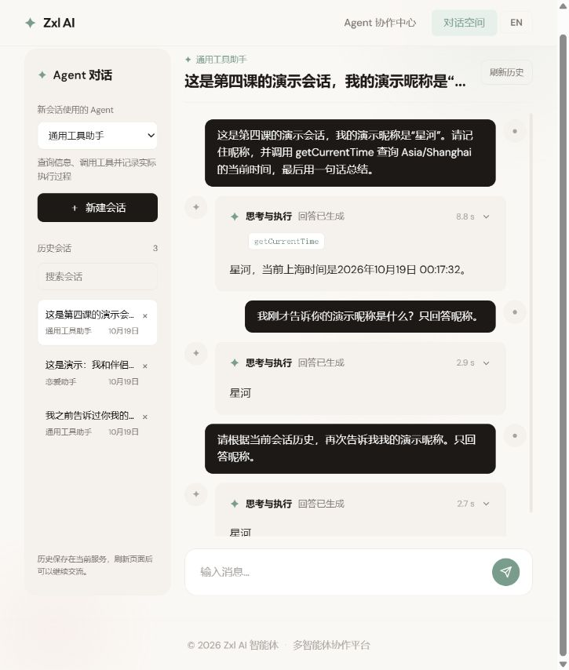
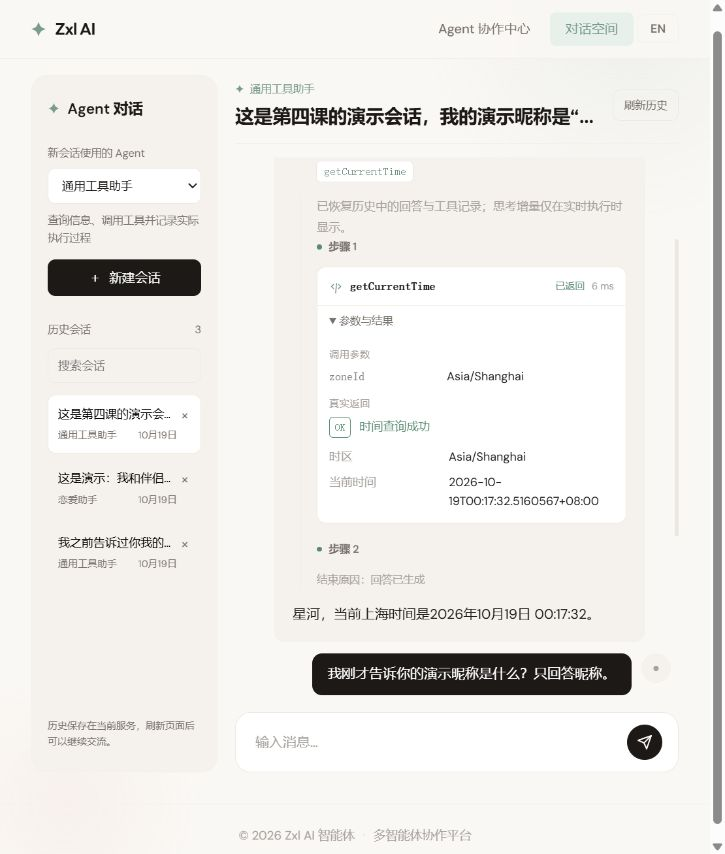

# 第四课实现记录：统一 Agent 会话

日期：2026-10-19。对应[第四课任务包](04-conversations-and-memory.md)。本次同时纳入用户的页面调整：恋爱助手是一种 Agent 类型，复用统一对话入口。

## 1. 现在怎么使用

打开 `/chat-room` 对话空间：

1. 在左侧选择“通用工具助手”或“恋爱助手”，再新建会话。
2. 在右侧交流，通用工具助手保留第三课的真实思考增量、工具卡片和结束原因。
3. 从左侧切换历史会话。刷新页面后，浏览器保存的当前 ID 用于恢复同一会话。
4. 会话类型在创建时固定。左侧类型选择作用于下一次新建，不会改变已有会话的角色和工具。
5. 删除会话需在页面再次确认；执行中的会话拒绝删除。

`/super-agent` 跳转到统一页面；`/love-master` 跳转到统一页面并选择恋爱助手类型。导航只保留 Agent 协作中心和对话空间。

旧 `LoveApp` 的 HTTP 接口、Kryo 历史仍保留。新的恋爱助手类型使用同一 JSON 会话引擎和流式适配器，并未自动迁移旧 Kryo 数据，也未默认接入旧 RAG 方法。

## 2. 一个请求怎样执行

```text
conversationId
  → 读取会话及固定的 agentType
  → 获取本会话的执行权（忙碌返回 409）
  → 按完整 Run 选取最近 8 轮上下文
  → Provider 注册表创建一个新的 Agent
  → 记录本次用户消息与 running Run
  → 恢复历史，再由 startRun 追加一次当前用户消息
  → 思考、工具、结果回填与最终回答
  → 完成监听器按 runId 保存终态和新消息
  → 释放执行权
  → 发送终态 SSE
```

`conversationId` 表示长期会话，`runId` 表示一次提交。Agent 对象只执行一次；恢复历史不需要把 FINISHED 改回 IDLE。

执行中的 running 记录先落盘。若服务进程重启，失去进程内执行权的遗留记录会在读取时变成 interrupted；不会自动重放可能已有副作用的工具。

## 3. Java 代码地图

| 文件 / 包 | 职责 |
| --- | --- |
| `conversation/model` | Conversation、MessageRecord、ToolCallRecord、RunRecord 等明确存储格式 |
| `ConversationRepository` / `FileConversationRepository` | 仓储边界；UUID 文件、版本校验、临时文件原子替换、明确的 I/O 错误 |
| `ConversationService` | 标题与 ID 校验、会话管理、重启遗留记录恢复 |
| `ConversationRunGuard` | 按会话获取 / 释放执行权，不跨线程解锁，不用全局长锁阻塞模型 |
| `ConversationMessageMapper` | Spring AI 消息与存储消息相互转换，保留原始工具调用 ID |
| `ConversationContextWindow` | 以完整 Run 为单位裁剪，排除未配对的工具消息组 |
| `AgentConversationService` | 协调恢复、Agent 创建、Run 开始 / 完成保存与去重 |
| `ConversationAgentProvider` / `ConversationAgentRegistry` | 新 Agent 类型的统一扩展入口 |
| `ManusAgentFactory` / `LoveAssistantProvider` | 通用工具助手与无文件 / 命令工具的角色型示例 |
| `BaseAgent` | 独立事件观察、完成监听和 SSE 输出；保存失败标为 PERSISTENCE_ERROR |

新增一个类型：实现 `ConversationAgentProvider` 并注册为 Spring Bean，提供 `definition()` 和 `create()`。注册表检查重复 ID；前端从目录接口读取选项，不需要为每种 Agent 增加页面。

## 4. 消息记录与上下文的区别

- 仓储保留完整消息记录。助手 `tool_calls` 与每条工具结果的 `toolCallId` 使用同一个原始 ID。
- 模型窗口默认只取最近 8 个完整 Run。不是对扁平消息列表随意截取最后 N 条。
- 工具异常或输出中断留下的不完整组不会交给下一次模型请求；页面仍可查看已记录的工具事件与部分回答。
- 内部 nextStepPrompt 只加入本轮 Prompt，不作为用户消息不断写入历史。
- 实时思考增量不进入模型恢复历史，也不写入 Run 展示记录。刷新后恢复回答与工具卡片，并提示思考仅在实时显示。
- Run 保存最多 2048 条展示事件，原始模型消息另外保存；这不是 Token 预算或长期记忆方案。

## 5. API 与错误

路径均包含应用的 `/api` 前缀。

| 方法 | 路径 | 请求 / 结果 |
| --- | --- | --- |
| GET | `/api/agent-types` | 可选 Agent 目录，含中英文名称与说明 |
| POST | `/api/conversations` | `{"agentType":"manus","title":"演示"}`；返回会话详情与服务端 UUID |
| GET | `/api/conversations` | 按更新时间倒序的摘要、类型与 busy 状态 |
| GET | `/api/conversations/{id}` | 完整消息、Run 与当前执行状态 |
| DELETE | `/api/conversations/{id}` | 空闲会话删除后返回 204；忙碌时 409 |
| POST | `/api/ai/agent/chat` | `{"conversationId":"UUID","message":"内容"}`；命名 agent SSE |

`RUN_STARTED` 及后续事件携带真实 `conversationId` 与 `runId`。前端使用 POST 流式请求，可以读取 409 的 `CONVERSATION_BUSY` 等结构化错误，且不会自动重连重提任务。

兼容保留 GET / POST `/api/ai/manus/chat` 和 GET `/api/ai/agent/chat`。未提供 conversationId 时创建默认通用工具会话，再通过事件返回实际 ID；新前端显式先创建会话并使用 POST。

| HTTP / 结束原因 | 含义 |
| --- | --- |
| 400 INVALID_CONVERSATION_REQUEST / INVALID_AGENT_TYPE | ID、标题、消息或类型无效 |
| 404 CONVERSATION_NOT_FOUND | 会话不存在 |
| 409 CONVERSATION_BUSY / CONVERSATION_CONFLICT | 已有任务执行 / 仓储版本已更新 |
| 500 CONVERSATION_CORRUPT / READ、WRITE、LIST、DELETE_FAILED | 损坏或存储操作失败；不伪装为空会话 |
| SSE PERSISTENCE_ERROR | 模型可能已产生结果，但本次结果未确认持久化 |

## 6. 配置与数据

可在本地配置中覆盖以下默认值：

```yaml
agent:
  conversation:
    storage-dir: runtime-data/conversations
    context-runs: 8
```

`context-runs` 范围为 1–50。每个会话一个 UUID JSON 文件；文件名不会直接使用客户端路径。`runtime-data/` 已被 Git 忽略，聊天数据不提交。

同一进程中，文件操作使用短锁、save 比较 version；执行权跨越完整模型任务。该实现不提供多实例文件锁、数据库事务、身份 / 租户授权或长期事实抽取。后续分别在数据库、记忆与权限课程实现。

## 7. 构建与页面观察

本轮没有新增或运行自动测试。构建命令：

```text
mvn -q -DskipTests compile
cd zxl-Ai-agent-fronted
npm run build
```

两项构建均通过。下面记录实际页面观察；不将其扩大为全部并发、故障与安全场景已通过。

| 场景 | 本次实际观察 |
| --- | --- |
| 会话 A 的昵称与工具 | 告知演示昵称“星河”并查询上海时间；8.8 秒完成，真实工具返回与回答已保存 |
| 刷新后继续 A | 显示原历史，再问昵称，2.9 秒回答“星河” |
| 重启后端后继续 A | 保持同一会话，再次追问昵称，2.7 秒回答“星河”；不依赖旧 Agent 对象 |
| 会话 B 隔离 | 新建通用工具会话询问昵称，4.1 秒回答“不知道” |
| 恋爱助手类型 | 在同一页面创建该类型，9.0 秒完成两句沟通建议 |
| 历史工具记录 | 重启后展开卡片，保留 Asia/Shanghai、原时间字符串与 6 毫秒工具耗时 |
| 界面语言 | 切换英文后类型名称、会话操作和执行标签变化，消息内容保留；随后恢复中文 |











独立只读审查后修正了：详情快照的 running / busy 一致性、HTTP 拒绝后的错误轮询、首次创建期间卸载仍发任务、删除成功后列表刷新失败的清理顺序、旧操作错误清除新操作 loading。这些修改完成编译检查，未宣称已执行相应故障注入测试。

并发竞争、存储损坏、不可写目录、窗口超过 8 轮等场景的自动化覆盖尚未新增。代码中的处理不等于这些故障场景已经实测。

## 8. 复盘

建议沿这条链读代码：`ConversationController → AgentConversationService → ConversationContextWindow → Provider → BaseAgent 完成监听 → FileConversationRepository`。

能解释“文件保存了什么、模型实际收到什么、为什么每次创建新 Agent”，才算掌握本课核心。接下来第五课处理多 Agent 的 Plan / Task 校验与依赖数据流。
