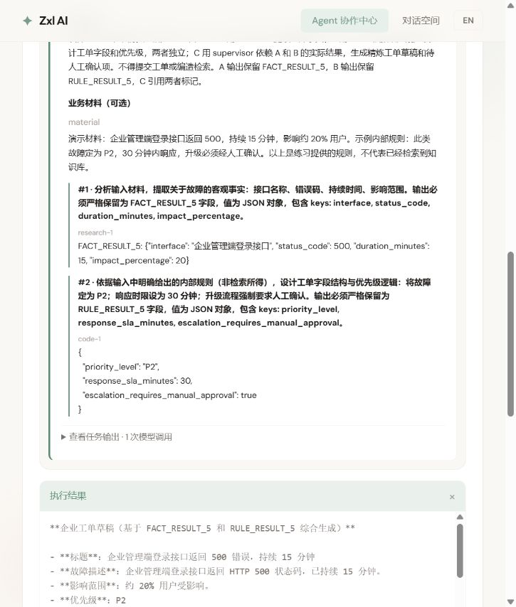

# 第五课实现记录：计划校验与依赖数据流

日期：2026-10-20。对应[第五课六项任务](05-plans-tasks-and-dataflow.md)。工程实现已完成；本轮完成编译、前端构建、独立静态审查及真实模型页面演示，**未新增或运行自动测试，未完成全部故障与并发验收矩阵**。

## 1. 六项任务落到了哪里

| 任务 | 实现入口 | 已实现行为 |
| --- | --- | --- |
| 模型计划契约 | planning/TaskDefinition、PlanCapabilities | 只允许描述、整数依赖索引、能力；research/code/supervisor，search/review 规范化 |
| 严格解析 | planning/PlanParser | JsonNode 检查类型、未知字段、重复 JSON 键与多余内容；两阶段生成 ID 和依赖映射，保留合法向后引用；错误不创建默认任务 |
| DAG 校验 | planning/PlanValidator | 非空、唯一 ID、合法依赖、无自依赖与环；Kahn 拓扑遍历只修改临时结构；拒绝伪造执行状态 |
| 编排失败边界 | OrchestratorAgent、WorkflowException / WorkflowError | 规划、解析、校验全部进入整体失败路径；Future 保留 code/path；注册能力和临时忙碌分开判断；不随机换角色 |
| 真实结果传递 | execution/TaskInputBuilder、TaskExecutionContext | 原始目标、深度只读业务输入、直接依赖实际输出与执行者；拒绝缺失输出；接收者不持有运行中 Plan/Task 引用 |
| 工作角色消费 | TaskPromptRenderer、三个工作角色 | 统一 JSON 上下文；Supervisor 支持普通任务节点，并保留 plan/allResults 旧入口；额外汇总也接收原始材料和全部成功产物 |

额外接入：WorkflowRun 生成每次执行的只读报告；控制器 POST SSE 推送递增序号；现有协作中心显示真实状态、直接依赖输入、输出、错误和应用模型调用数。研究/代码/监督角色没有新建独立页面，统一对话的 Agent 类型机制继续保留。

## 2. 为什么这样分职责

```text
用户 goal + context
  → Planner 输出受限 JSON
  → PlanParser 检查类型、生成运行时 ID、转换全部依赖
  → PlanValidator 检查图与已注册能力
  → Orchestrator 选择就绪任务和匹配实例
  → TaskInputBuilder 注入只读业务材料与直接依赖结果
  → TaskPromptRenderer 渲染同一份输入
  → 工作 Agent 请求模型
  → 任务结果 → 后继任务 / 最终结果
```

模型提出任务，Java 决定是否接受以及何时执行。任务数组顺序不是执行顺序；依赖完成与依赖结果传递分别由调度器和输入组装器负责。

没有把工作角色接入文件操作、联网检索或工单写入工具。ResearchAgent 已移除未实现的 web_search 声明；当前分析的是明确提供的材料。CodeAgent 返回设计或代码文本，没有执行或部署能力。

## 3. 页面演示记录

入口：[本地协作中心](http://127.0.0.1:5174/multi-agent)，点击“填入工单助手示例”，再点“执行”。

合成材料：企业管理端登录返回 500，持续 15 分钟，约 20% 用户受影响；练习规则为 P2、30 分钟内响应、升级必须人工确认。

最终版本页面观察：

| 项目 | 观察结果 |
| --- | --- |
| 任务图 | A/research 和 B/code 独立，C/supervisor 依赖 A、B |
| C 的输入卡片 | 有原始目标、material、research-1 的事实 JSON、code-1 的 P2/SLA/人工确认规则 JSON |
| 执行结果 | 3/3 任务 COMPLETED，最终工单草稿包含故障、影响范围、P2、30 分钟响应和待人工确认项 |
| 模型调用 | 规划 1 + 任务 3 + 额外汇总 0，共 4 次应用发起调用 |
| 页面耗时 | 本次 15.5 秒；这是单次观察，不是性能基准或服务承诺 |
| 收尾 | 五个角色恢复 IDLE，activePlans 和 pendingTasks 回到 0 |
| 语言切换 | 已有任务结果保留，界面标签即时切换中英文，不翻译模型原文；最终恢复中文 |

[完整运行页面](../images/lesson5-workflow.png) · [展开的依赖输入](../images/lesson5-dependency-input.png) · [英文详情](../images/lesson5-workflow-en.png)



输入卡片来自应用构造并交给任务的 executionContext，静态读取路径为 TaskPromptRenderer.render → callLlm。**本轮未截取供应商 HTTP 请求载荷**，也未用可控替身断言全部 Prompt；最终答案出现某个标记本身不作为充分的数据流证据。B 的实际结果是规则 JSON，没有严格包裹 RULE_RESULT_5 键，当前工作产物仍是文本契约；结构化业务产物验证是后续评估与业务接入需要补充的内容。

## 4. 本轮发现并修正的问题

1. 首次页面演示规划结束后报 INVALID_PLAN_JSON：Plan 的计算 getter 被当成 JSON 属性参与往返。为 isComplete / getReadyTasks 加 JsonIgnore，避免计算属性成为传输状态；修正后正常进入任务执行。该次失败没有发起业务工作任务。
2. 独立静态审查发现额外最终汇总丢失原始业务输入。现在 synthesize 显式接收 userInput，为合成汇总任务注入原始目标、业务材料、全部成功结果，并保留旧字段兼容。额外汇总期间显示独立阶段。
3. 早期模型输出增加了材料未提供的优先级阈值。统一渲染提示增加“提供的规则 / 设计建议 / 待确认项”的区分，监督角色核对原始材料。最终演示未把这些额外阈值写入工单草稿。**提示词约束不能作为制度正确性的硬保证**；企业接入仍需权威知识、规则校验、审批与评估。
4. 已收到终态报告后关闭流，页面保留确认过的结果，不因后续连接结束又显示“结果未知”；同一个失败不重复显示两段错误。
5. 非法候选计划先校验，成功后才进入运行报告，避免错误处理再次读取非法 tasks 造成二次异常；补齐运行时错误字段与调用数的入口校验。

按 systematic-debugging 的定位方式，页面症状、序列化边界和实际返回分别检查；不要求学习者逐行断点。

## 5. 构建与审查证据

- `mvn -q -DskipTests compile`：退出码 0。
- `npm run build`：vue-tsc 与 Vite 生产构建退出码 0。
- 后端成功启动，5 个角色注册；最终页面执行完成并恢复空闲。
- 独立只读审查返回 1 个 P2（额外汇总缺失原始输入），已修正并由主执行者复核调用路径；修正后未完成第二次独立复审。
- 本轮没有运行自动测试或基准接口，不能沿用第三课的 48 个用例数量描述第五课覆盖率。

## 6. 配置和协议边界

同步入口继续接受 `POST /api/ai/multiagent/orchestrate`；新增 POST 流入口 `/api/ai/multiagent/orchestrate/stream`，请求体：

```json
{"goal":"生成工单草稿","context":{"material":"故障事实与明确规则"}}
```

流事件：report 是结构化快照，complete 保留最终文本，error 是 code/path/message。旧 GET 流入口保留。前端使用 POST，避免把业务材料写入 URL；终态后关闭连接，不自动重发业务请求。

当前保护上限：目标 12000 字符、业务输入序列化后 32000 字符、模型计划 64000 字符、最多 20 个任务、单描述 2000 字符、直接依赖总输出 100000 字符。超出时明确失败，不静默截断。这些是本课程的工程边界，不是模型 token 预算。

模型调用数记录应用进入 callLlm 的次数，包含失败尝试；不代表 token、费用，也不单独统计 SDK 内部重试。

## 7. 未覆盖和后续任务

- 合法向后引用、各类错误依赖类型、重复 ID、环、缺少输出、不同计划争用等已写检查分支，但**本轮未运行对应专项用例矩阵**。
- 旧整体汇总入口与新增额外汇总上下文经静态复核，最终演示走的是 C 作为唯一 Supervisor 汇合节点的路径，没有单独进行额外汇总真实模型演示。
- 本轮没有单 Agent / 多 Agent 的同题质量和耗时对照，不根据 4 次调用宣称多 Agent 更快或更准确。
- 当前采用整轮等待：每轮同一工作实例最多一项；本计划同角色就绪任务下一轮再调度，跨计划忙碌直接报错。完整容量、排队与截止时间在第七课实现。
- 当前失败后停止后续调度，未启动任务标 BLOCKED；精确根因、原子状态迁移、终态不可回退和迟到结果在第六课完善。
- 等待超时不等于底层模型停止，任务字段仍可能被迟到完成覆盖；报告不是持久化事件日志，刷新后无法恢复本次多 Agent 任务。
- 本轮用本地现有配置启动，其他后端工作区改动仍保留，未提交本地配置或凭据；新环境仍需配置模型与 MCP。

**下一课：[生命周期与失败传播](06-lifecycle-and-failure-propagation.md)。** 六项任务一起建立任务状态所有者、统一完成边界、失败因果、整体结果、页面一致性和集中验收。
