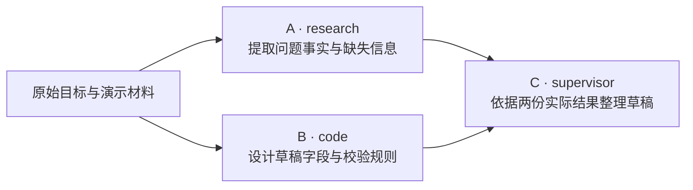

# 第五课：Plan、Task 与依赖数据流

日期：2026-10-20。面向能写 Spring Boot 接口、已接触工具调用和会话恢复的开发者。

本课目标：把模型生成的计划变成可校验、可调度、能向下游传递真实结果的任务图。建议连续完成 6 项任务，预留 3–4 小时；前端仍由助手负责，不要求逐行断点。

六项工程任务已实现，构建和真实模型页面观察见[实现记录](05-implementation.md)。下文保留任务要求与验收矩阵；本轮未新增或运行自动测试，不宣称已覆盖全部故障和并发案例。原有初始化与失败处理修正已作为独立前置提交收录，其他工作区修改保留。

## 1. 与前四课有什么联系

前四课建立一个 Agent 的模型调用、工具执行、结束原因与会话恢复。本课处理一次复杂请求内部的任务分工。

第四课的 Agent 类型决定“用户选择哪个助手”；本课的任务图决定“一个复杂目标内部，由哪些工作 Agent 按什么依赖执行”。这两层目录当前是不同模块，不要为了接通任务图先合并会话存储或为每个工作 Agent 新建页面。

一个简单问答继续由单 Agent 处理即可。任务图适合需要不同职责、独立输入或可核查中间产物的目标；增加角色本身不保证答案更好。

## 2. 先理解六个概念

| 概念 | 在本课中的含义 | 谁负责 |
| --- | --- | --- |
| Goal | 用户原始目标与明确给出的业务材料 | 应用接收和保存 |
| Plan | 为一个目标组织的任务集合及依赖 | 模型提出，应用校验和接受 |
| Task | 一项有描述、输入、输出和运行状态的工作 | 工作 Agent 执行 |
| DAG | 有向无环图；边 `A → C` 表示 C 依赖 A | 应用检查结构、计算就绪任务 |
| DependencyResult | 某个直接上游任务实际完成后的输出 | 应用从任务结果中构造 |
| ExecutionContext | 当前任务实际收到的目标、业务输入和上游结果 | 应用组装，工作 Agent 消费 |

**依赖关系决定什么时候能执行；依赖结果决定执行时拿到什么。** `A.status == COMPLETED` 不会自动让 C 的模型请求包含 `A.result`。

模型生成的计划是待处理数据。它不能自行决定数据库 ID、运行状态、已分派 Agent、错误字段或实际执行结果。

第三课的 ToolResult 规范工具方法的执行返回；本课校验的是模型提出的计划结构。统一工具返回并不能代替计划校验。

## 3. 企业业务练习：整理工单草稿

使用以下合成材料，后续接入真实知识库前先把调度机制做正确：

```text
目标：根据问题描述与演示规则，整理一份工单草稿和待确认事项。
问题：企业后台登录接口持续 15 分钟返回 500，约 20% 用户受影响。
演示规则：生产环境部分用户的核心功能受影响时标记为 P2，首次响应目标为 30 分钟。
是否通知值班工程师需要人工确认。以上规则仅用于课程，不代表真实企业制度。
```

先用固定三任务计划理解机制：



A、B 没有相互依赖，结构上可以同时就绪；C 必须等二者完成，且收到两份实际结果。当前只有一个 research 实例，故意让 A、B 使用不同工作角色，避免把“两个任务同时就绪”误当作“一个实例已支持并发”。并发名额与等待队列在第七课展开。

本课只生成草稿文本，不创建真实工单、不实现 RAG 检索或审批写入。结果暂用现有 `Task.result: String`；草稿看起来像 JSON，也不等于已经完成业务字段校验。

## 4. 结合当前代码看问题

以下保留 2026-10-20 实施前的代码问题，用于理解改动原因；右列改动已实现，实际覆盖见[实现记录](05-implementation.md)。表中的旧方法可能已移除。

| 位置 | 当前机制 / 问题 | 本课改动 |
| --- | --- | --- |
| [PlannerAgent.parsePlanFromLlmResponse](../../src/main/java/com/zxl/zxlaiagent/multiagent/agents/PlannerAgent.java) | 使用 `List<Map<String,Object>>`、强制转换和 `Number.intValue()`；字段类型不严格 | 定义输入 DTO，解析前检查 JSON 节点类型 |
| 同一解析方法 | 边建 Task 边转换依赖，仅保留已创建节点；指向后面任务的合法依赖被丢弃 | 两阶段创建全部 ID，再解析所有依赖 |
| `extractJsonArray` 与解析异常分支 | 截取首尾方括号；错误内容可被包装成任务，解析失败也生成默认任务 | 明确格式边界，无效计划显式失败 |
| [Plan.getReadyTasks](../../src/main/java/com/zxl/zxlaiagent/multiagent/model/Plan.java) | 检查 PENDING 与依赖完成；未做完整图校验 | 分派前校验空计划、重复 ID、未知依赖、自依赖和环 |
| [OrchestratorAgent.createPlan](../../src/main/java/com/zxl/zxlaiagent/multiagent/orchestration/OrchestratorAgent.java) | 规划器缺失或出错后又创建默认单任务；规划发生在主要 try/catch 之前 | 保留规划错误，并纳入整体失败路径 |
| `executeSingleTask` / `executeFallback` | 正常分派前未统一注入依赖输出；fallback 只发送任务描述 | 建立明确的输入组装边界，禁止隐式换角色补执行 |
| [CodeAgent](../../src/main/java/com/zxl/zxlaiagent/multiagent/agents/CodeAgent.java) / [ResearchAgent](../../src/main/java/com/zxl/zxlaiagent/multiagent/agents/ResearchAgent.java) | 使用 `task.input.toString()` 拼上下文 | 使用统一的结构化上下文渲染 |
| [SupervisorAgent](../../src/main/java/com/zxl/zxlaiagent/multiagent/agents/SupervisorAgent.java) | 目前只读取 `plan`、`allResults`，普通依赖输入会被忽略 | 让任务节点读取 executionContext，并保留原最终汇总入口兼容 |

ResearchAgent 的提示词宣称搜索，不代表当前已经调用搜索工具；本课只使用给定演示材料。

## 5. 六项工程任务

### 任务一：定义模型计划契约

建议新增 `multiagent/planning/TaskDefinition.java`。它表示模型可以输出什么，与运行中的 `Task` 分开。

```java
public record TaskDefinition(
        @JsonProperty("task_description") String description,
        List<Integer> dependencies,
        @JsonProperty("required_capability") String requiredCapability) {
}
```

约定模型输出数组，例如：

```json
[
  {"task_description":"提取问题事实与缺失信息","dependencies":[],"required_capability":"research"},
  {"task_description":"依据演示规则设计草稿字段与校验规则","dependencies":[],"required_capability":"code"},
  {"task_description":"结合实际事实与字段规则整理工单草稿","dependencies":[0,1],"required_capability":"supervisor"}
]
```

本课先限定以下规则：

- 任务数量 1–20；模型响应不超过 64,000 个字符；描述为非空字符串且不超过 2,000 字符。
- 每项必须包含这三个字段；拒绝未知字段，尤其是 `id`、`status`、`result` 等运行字段。
- dependencies 必须是数组，元素必须是真正的 JSON 整数；拒绝 `"0"`、`0.5`、`null`、布尔值与越界整数。
- 索引范围是 `0 <= index < 任务数量`，不能重复、不能依赖自身。
- 模型可使用的规范能力为 `research`、`code`、`supervisor`；显式兼容 `search → research`、`review → supervisor`。
- 其他能力拒绝，不再让未知值走 default 随机选角色。规范类型应对应已注册工作 Agent；临时忙碌与“未注册类型”分开处理。

同步修改规划提示词。这里限定的是本项目当前可执行角色，不是通用 Agent 能力全集。

**提醒：有了 record 不等于严格校验。** Jackson 默认转换可能把某些非整数输入变成 Integer。可先用 JsonNode 检查节点类型和整型范围，再转换 DTO；不要只依赖字段类型。

### 任务二：解析计划，并做两阶段依赖转换

建议新增 `multiagent/planning/PlanParser.java`，由已有 `parsePlanFromLlmResponse` 委托调用，保留清晰的入口。

```java
public Plan parse(String modelOutput, String originalGoal);
```

执行顺序：

```text
检查长度、格式
→ 解析完整 JSON
→ 检查字段类型与约束
→ 转成 List<TaskDefinition>
→ 第一遍为所有定义创建 Task 和服务端 UUID
→ 第二遍把全部依赖索引转换为对应 Task ID
→ PlanValidator 校验
→ 返回可分派的 Plan
```

格式仅接受裸 JSON 数组，或整段被一个 json 代码围栏包裹的数组。拒绝解释文字混排、多个顶层 JSON 和尾随垃圾；使用完整输入解析约束，不能靠截取首个 `[` 到最后一个 `]` 修复。

必须保留这个合法情况：数组中第 0 项依赖第 1 项，而第 1 项没有依赖。任务数组的排列不是调度顺序；只要无环，向后引用就应保留。

ID、PENDING 状态、创建时间由应用生成；原始目标由应用传入。规划任务不应把 `Decompose:` 之类内部指令混进业务目标。

验收点：合法前向引用不丢失；无效 JSON 不生成替代任务；用户当前目标没有被模型输出覆盖。

### 任务三：实现纯 Java 的 PlanValidator

建议新增 `multiagent/planning/PlanValidator.java` 与 `PlanValidationException.java`。

```java
public void validate(Plan plan);
```

异常至少携带 `code`、`path` 和安全的错误说明；例如 `path=tasks[2].dependencies[0]`。校验器不调用模型、不执行任务、不修改任务状态。

校验内容：

1. Plan、目标和任务列表有效，任务数量符合上限。
2. 每个 Task 非空、ID 非空且唯一、描述非空。
3. 入口任务均为 PENDING，没有伪造的 result 或已分派状态。
4. 能力合法且有对应注册类型；判断注册情况时不能把暂时 BUSY 当成类型不存在。
5. 每条依赖引用存在，不能重复、自引用或组成环。

本课用 Kahn 算法：建立 `上游 → 下游` 邻接表与入度，先把入度为 0 的节点入队；依次取出节点，减少其下游入度。最终处理数量小于任务总数时，图中存在环。复杂度为 `O(V + E)`。

邻接表、入度是校验过程的临时数据，不要靠修改 `Task.status` 来“走完一遍图”。

建议错误码：`INVALID_PLAN_JSON`、`INVALID_PLAN_FIELD`、`EMPTY_PLAN`、`TOO_MANY_TASKS`、`DUPLICATE_TASK_ID`、`UNKNOWN_DEPENDENCY`、`SELF_DEPENDENCY`、`PLAN_CYCLE`、`UNSUPPORTED_CAPABILITY`。

验收点：未知依赖和环在任何业务任务执行前被拒绝，而不是等调度器发现“没有 ready task”。

### 任务四：让规划失败沿调用链明确返回

修改 PlannerAgent 与 OrchestratorAgent：

- 移除解析错误、规划器缺失和规划异常时的隐式默认单任务。
- 把创建、解析、校验计划放进统一的异常处理范围；校验通过后再进入 activePlans 和 executePlan。
- 规划器执行会调用一次模型；本课“未执行任务”的含义是**未分派任何业务工作 Task**，并非没有调用规划模型。
- Future 包装异常要保留或解包到原始错误码；控制器不能把所有规划失败变成无法定位的字符串。
- 尚未创建 Plan 时也要给出明确的整体失败事件；构造事件数据时避免把 null 放进 Map.of。
- 分派依据规范能力做确定匹配，不按可用实例随机选择其他职责；Agent 临时忙碌明确返回 `AGENT_BUSY`，完整排队与并发名额在第七课实现。

本课可以沿用现有响应外层，在失败响应里补上 code、path，例如：

```json
{"success":false,"code":"PLAN_CYCLE","path":"tasks","error":"任务计划包含循环依赖"}
```

规划失败后自动改为单 Agent 是一种独立产品策略，未来若引入应明确触发条件与可见标记。本课选择显式失败，便于识别计划缺陷。

### 任务五：向任务注入实际依赖结果

建议新增 `multiagent/execution/DependencyResult.java`、`TaskExecutionContext.java` 与 `TaskInputBuilder.java`。

```java
public record DependencyResult(
        String taskId, String description, String agentId, String result) {
}

public record TaskExecutionContext(
        String goal,
        Map<String, Object> userInput,
        List<DependencyResult> dependencyResults) {
}
```

任务分派前，由应用构造独立快照：

1. 根据任务声明的直接依赖 ID 查找上游 Task，保持声明顺序。
2. 只读取已 COMPLETED 且有可用结果的依赖；缺少结果时明确报错，不把 null 当成正常上下文。
3. 使用实际结果和实际 assignedAgentId，不让模型填写；分派时补齐 assignedAgentId。
4. 无依赖任务也获得原始 goal 与用户输入。
5. 只注入直接依赖，不把整个 Plan、无关任务结果或其他会话历史一起塞入。
6. 为每个接收者复制数据；不要把可变 Plan、Task 对象直接作为上下文共享。Map.copyOf / List.copyOf 只做浅层容器保护，嵌套业务数据也需要复制。

保留原 `Task.input` 中经应用确认的 capability，把执行上下文放在保留键 `executionContext` 下；用户输入单独放入 userInput，不能覆盖应用组装的依赖结果。

把原始 context 沿 `orchestrate → executePlan → executeSingleTask → TaskInputBuilder` 显式传下去。当前代码仅交给规划器，不能假设它会自然出现在工作 Agent 的 Prompt 中。

验收点：给 A、B 的结果分别设置固定标记 `FACT_RESULT_5`、`RULE_RESULT_5`，C 实际收到的模型输入必须同时包含二者；无关任务的标记不能出现。检查实际输入，不能只看最终答案“似乎引用了上游”。

### 任务六：让工作 Agent 真正读取上下文，并集中检查

建议新增 `multiagent/execution/TaskPromptRenderer.java`。由 CodeAgent、ResearchAgent 和任务节点模式下的 SupervisorAgent 共用，把 Task 描述及 executionContext 序列化为明确结构。

不要继续使用 Map.toString()。上下游结果是待处理数据，即使包进 JSON，也没有因此成为可信系统指令。工具授权不能交给这段文本决定。

SupervisorAgent 目前有两种用途：普通计划任务节点与 orchestrator 最后的整体汇总。新增 executionContext 消费时，保留现有 plan / allResults 汇总入口，避免改完后最终结果反而丢失。

前端所需的规划错误、任务与输入摘要展示由助手衔接现有界面，不要求你编写 Vue，也不增加独立工作 Agent 页面。若最终汇总又额外调用了一次 Supervisor，要在调用次数中如实记录。

先用固定三任务计划验证 Java 机制，再接真实 Planner。真实模型可能选择不同分解，不能要求每次都生成完全相同的任务图。

## 6. 集中验收清单

以下是实施后的验收目标，本次发课没有创建或运行这些测试。

| 场景 | 需要看到的结果 |
| --- | --- |
| 三任务 A、B → C | A、B 完成后 C 才开始；C 收到两份真实结果 |
| 合法向后引用 | 依赖保留，按图执行而不是按数组顺序执行 |
| 依赖是 `"0"`、0.5、null | 类型错误，不截断、不忽略 |
| 空数组、描述缺失、未知运行字段 | 明确拒绝，业务工作 Task 调用次数为 0 |
| 越界索引、未知运行任务 ID | UNKNOWN_DEPENDENCY 或明确的字段错误 |
| 自依赖、重复 ID、两个节点互相依赖 | 分别拒绝，环不会进入调度循环 |
| 规划器缺失 / 输出无效 | 整体失败，保留错误码，不伪造成功的默认计划 |
| 未注册能力 / 暂时忙碌 | 区分不支持与忙碌，不换成其他职责 Agent |
| 上游完成但结果缺失 | 拒绝组装依赖上下文，C 不带空结果继续执行 |
| A 的结果改变 | C 的实际模型输入同步改变；无关任务结果不注入 |
| 无依赖任务与最终汇总 | 仍得到原始目标与业务输入；原汇总入口可用 |
| 单 Agent 与多 Agent 对照 | 记录同目标的结果、模型调用次数和耗时，说明分工是否值得 |

计划校验与上下文组装优先用不依赖真实模型的本地用例检查。实际模型只用于必要的规划和端到端案例；页面中的时间顺序不能替代并发与数据流断言。

## 7. 一次完成的学习安排

| 批次 | 连续完成 | 交付 |
| --- | --- | --- |
| 第一批，约 90 分钟 | 任务一、二、三 | 契约、严格解析、两阶段 ID 转换与图校验 |
| 第二批，约 90 分钟 | 任务四、五、六 | 明确失败路径、真实输入传递与工作 Agent 消费 |
| 集中复盘，约 30–60 分钟 | 正常 / 错误案例、单 Agent 对照 | 验收证据、代码地图和面试表述 |

提交按职责拆分：计划契约与解析、图校验、编排入口、依赖输入、工作 Agent 消费、文档与验收记录。只暂存对应修改，每批完成后 git push。

本课优先做正确的计划和数据流。任务完整状态机与失败传播在第六课继续，取消与资源配额在第七课继续；当前资源容量不足时如实报错，不宣称已支持任意并行度。

## 8. 面试复盘

完成后，用本项目解释以下问题：

1. 模型输出能解析成 JSON，为什么还不能执行？
2. 为什么依赖索引转换要分两遍？合法向后引用与循环有什么区别？
3. 拓扑排序与任务调度器各自做什么？
4. 依赖完成与依赖结果传递，为什么是两个机制？
5. 为什么传直接依赖结果，而不是共享所有 Agent 的完整历史？
6. 一个 Task 已经 ready，为什么仍可能没有可用 Agent？
7. 为什么不在规划出错时悄悄改成另一个执行策略？
8. 哪类请求用单 Agent 更合适？多 Agent 的收益来自哪里，代价怎样记录？

## 9. 参考阅读

- [ai-agent-book 第十章](https://github.com/bojieli/ai-agent-book/blob/dbc046eb896ac4e39aa19c7774c8bf49583b89a6/book/chapter10.md)：选读“上下文是否共享”“协作拓扑”和“多 Agent 何时真正优于单 Agent”，用于理解分工与显式通信的取舍。
- [Shannon DAG 工作流](https://github.com/Kocoro-lab/Shannon/blob/391b619130281502d227a53dd97238c9791bf174/go/orchestrator/internal/workflows/strategies/dag.go)：定位 ValidateDAGDependencies 与 hasDependencies，观察校验发生在何时、依赖怎样影响执行模式。

沿用课程已固定的两个提交，本次重新查看相关章节与 DAG 源码；未部署或运行参考项目。上述 Java DTO、错误码、允许能力与显式失败策略是本课程的工程设计，不代表照搬 Shannon 的全部降级行为。


下一课：[第六课：生命周期与失败传播](06-lifecycle-and-failure-propagation.md)。
