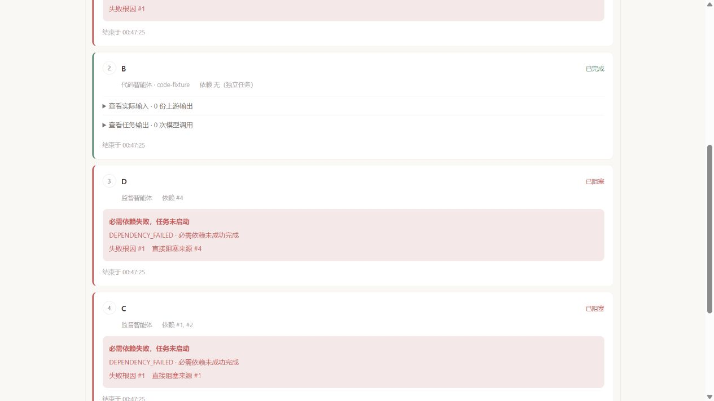

# 第六课实现与验收记录

日期：2026-10-21。对应[生命周期与失败传播六项任务](06-lifecycle-and-failure-propagation.md)。六项工程任务已完成；本轮运行了本课明确要求的集中验收，证据区分专项用例、真实模型页面及替身记录预览。

## 1. 改动与职责

| 本课任务 | 实现 | 行为 |
| --- | --- | --- |
| 原子状态 | TaskSnapshot、TaskLifecycle | 状态、产物、失败、执行者、调用数与时间一次 CAS 更新；无效迁移 applied=false，终态不再变化 |
| 唯一完成边界 | AbstractBaseAgent.executeTask | 同步异常、失败 Future、null Future、空产物、成功都经过同一完成函数；真实工作结束后释放占用，SHUTDOWN 不回退 |
| 失败因果 | FailurePropagation | 先传播 DEPENDENCY_FAILED，再以 PLAN_ABORTED 阻塞其他未启动任务；保留直接阻塞来源与根任务 ID |
| 统一结果 | WorkflowOutcome、WorkflowRun | 整体结果只决定一次；主任务与额外汇总均成功才完成；终态报告冻结快照，不再接受 running 更新 |
| 接口与页面 | MultiAgentController、WorkflowReportPanel | HTTP 与终态 SSE 使用同一 outcome；显示根因、阻塞来源、结束时间、规划与额外汇总状态 |
| 集中验收 | 四个专项测试类、相关旧用例、本地预览 | 用可控 Future 制造故障、竞争与迟到结果；真实模型演示正常路径 |

Observer 现在保存各类执行事件中的已提交 TaskSnapshot，完成耗时使用 completedAt - startedAt；进行中的任务不再被统计为已完成。

## 2. 状态和完成边界

```text
PENDING → IN_PROGRESS → COMPLETED / FAILED
PENDING → BLOCKED
未结束状态 → CANCELLED（本课仅提供生命周期入口，尚无业务取消 API）

实际调用完成
  → TaskLifecycle 决定一次终态
  → 只有 applied=true 才发终态事件
  → finally 条件释放 BUSY
  → 完成调用者的等待 Future
```

等待超时由编排器将任务决定为 FAILED；底层迟到回调不能覆盖这个快照。Agent 仍保持 BUSY，直到实际调用结束。取消返回给调用者的等待 Future 不会让底层清理回调脱离执行链。

Task 不再提供 setStatus / setResult / setError 等独立运行时写入口。运行时 JSON 改为一个 execution 快照；模型计划仍只输出原来的三字段定义。内部快照恢复只用于 JSON 反序列化，计划入口继续验证其等于全新的 PENDING 快照，并拒绝旧式伪造状态字段。

本课按轮调度，当前轮已分派分支等待收敛；发现失败后不调度下一轮。它不是对已发出调用的实时取消机制。首个整体根因按已失败任务结束时间选择，同时间按计划顺序稳定选择；依赖传播优先保留位于自身依赖链内的既定根因，不受依赖数组顺序影响。

## 3. 专项与回归结果

最终命令：

```powershell
mvn -q "-Dlesson6.exportReports=true" "-Dtest=AgentCompletionBoundaryTest,TaskLifecycleTest,WorkflowOutcomeTest,ObserverSnapshotTest,MultiAgentOrchestrationTest" test
```

| 测试类 | 数量 | 覆盖重点 |
| --- | ---: | --- |
| AgentCompletionBoundaryTest | 8 | 同步 / 异步失败、空输出、null Future、观察异常、迟到完成、SHUTDOWN、等待 Future 取消、事件准备失败 |
| TaskLifecycleTest | 4 | 非法迁移、终态保护、20 轮双线程完成 / 失败竞争、阻塞 / 取消、计划往返与伪造状态 |
| WorkflowOutcomeTest | 11 | 成功数据流、分支失败与根因、规划失败、额外汇总失败 / 不可用、超时迟到、终态报告、HTTP 一致、依赖顺序与规划器缺失 |
| ObserverSnapshotTest | 1 | 已提交快照、真实耗时、未完成计数、事件历史独立快照 |
| MultiAgentOrchestrationTest | 24 | 既有相关回归；两个旧夹具改用合法生命周期迁移，原断言保留 |
| **合计** | **48** | **0 failures、0 errors、0 skipped** |

共新增 24 个专项用例，另运行 24 个相关旧用例；没有运行依赖外部模型 / MCP 的全套测试。它们不同于第三课的 48 个专项用例，不能混作一套覆盖率。

实施前，首批 6 个用例有 4 个失败，复现空 Future 泄漏、空输出残留、事件异常打断清理、迟到成功覆盖失败。独立审查发现的两处边界，以及规划器缺失的关联问题，也先由 3 个失败用例复现，再修正通过。

超时用例使用可控等待 Future 让 get 立即抛 TimeoutException，再手动完成实际工作，覆盖真实编排超时处理分支；没有实际等待 120 秒，也没有验证供应商 HTTP 请求中断。

## 4. 真实模型与页面

本机后端使用现有 local 配置启动，5 个角色注册。协作中心的工单示例完成：

- 3/3 个工作任务成功；research、code 两个独立分支后，supervisor 读取其输出。
- 规划 1 次、工作任务 3 次、额外汇总 0 次，共 4 次应用模型调用。
- 本次页面耗时 16.9 秒；规划、每项任务都有结束时间。
- 页面显示 18 条真实执行事件；5 个角色恢复空闲，activePlans / pendingTasks 均为 0。
- 生成的是基于给定材料的待人工确认工单草稿，没有知识检索或工单写入。


## 5. 故障页面的可复核证据

开发预览入口：[本地执行记录检查](http://127.0.0.1:5174/dev/lesson6/index.html)。这里复用 WorkflowReportPanel，读取上面专项用例导出的真实运行报告；不是供应商故障，也不发起模型调用。

| 场景 | 页面观察 |
| --- | --- |
| A 失败，B 已启动 | A FAILED，B COMPLETED，C、D DEPENDENCY_FAILED，E PLAN_ABORTED；C/D 的根因仍为 A |
| 主任务成功、汇总失败 | 2/2 工作任务成功，额外汇总 FAILED，整体仍失败，明确说明完成比例不代表整体成功 |
| 规划失败 | planId 为空，规划任务 FAILED，业务任务没有启动 |
| 连接中断文案 | 显示结果未知、后台可能继续；这里只检查提示展示，没有执行真实断网实验 |
| 英文卡片 | 状态、根因、阻塞来源、时间标签正确切换；后端错误消息保留原文 |

[失败概览](../images/lesson6-failure.png) · [汇总失败](../images/lesson6-synthesis-failure.png)



准备本地记录的命令，在上述专项用例执行后运行：

```powershell
cd zxl-Ai-agent-fronted
node scripts/prepare-lesson6-preview.mjs
npm run dev -- --host 127.0.0.1 --port 5174
```

生成 JSON 与 target 运行数据均忽略，不提交到 Git。预览入口只由开发服务器提供，正常生产构建没有这个 HTML 入口；生产构建仍检查预览代码的类型。

## 6. 独立审查与修正

- 额外汇总领取 Agent 失败时，任务原本残留 PENDING。现在准备、领取、执行都在统一边界内；失败留下 BLOCKED 快照、结束时间和 synthesis 整体错误路径。
- 多依赖失败时，原实现按 dependencies 首项选择根因。现在保留当前依赖链中的既定根因，否则比较根任务时间；直接阻塞列表完整保留。
- 同步处理了缺失规划器时规划任务残留 PENDING 的情况。
- 主执行者补充检查了用户业务字段与运行元数据隔离：业务输入中的 capability 等字段不能改变规划角色报告或造成类型转换异常。
- 规划阶段保留 `tasks[0].dependencies[0]` 等精确校验路径；阶段标签不覆盖字段位置，原第五课的 code/path 契约继续有效。

独立只读复核确认两项 P2 已修正，未发现新增 P1/P2。审查者没有修改代码或运行测试；测试结果由主执行者核对。

## 7. 构建、协议与边界

- Maven 专项与相关回归退出码 0，前端 vue-tsc 和 Vite 生产构建退出码 0。
- HTTP 成功 / 业务失败响应新增 outcome，同时保留 success / result / code / path / error 兼容字段。终态 SSE report.outcome 使用同一份冻结结果；complete / error 事件保留。
- 请求层超时无法判定后台结局，响应使用 executionStatus=unknown，不伪造业务终态。
- 前端检查请求代次、递增序号和已接收终态，旧连接或迟到运行消息不能覆盖新执行 / 最终结果。
- 当前没有统一总截止时间、业务取消 API、有界排队或真正的模型客户端中断。这些是第七课内容。
- 仍为单进程内存运行，不具备重启恢复、跨实例租约、租户授权或持久化事件重放。Observer 全局指标仍是本地统计，不作为分布式监控和质量评估的替代。
- 本机现有其他后端改动与本地配置保留，未提交凭据、运行文件或压缩备份。

下一课：[截止时间、取消与并发容量](07-deadlines-cancellation-and-capacity.md)。
