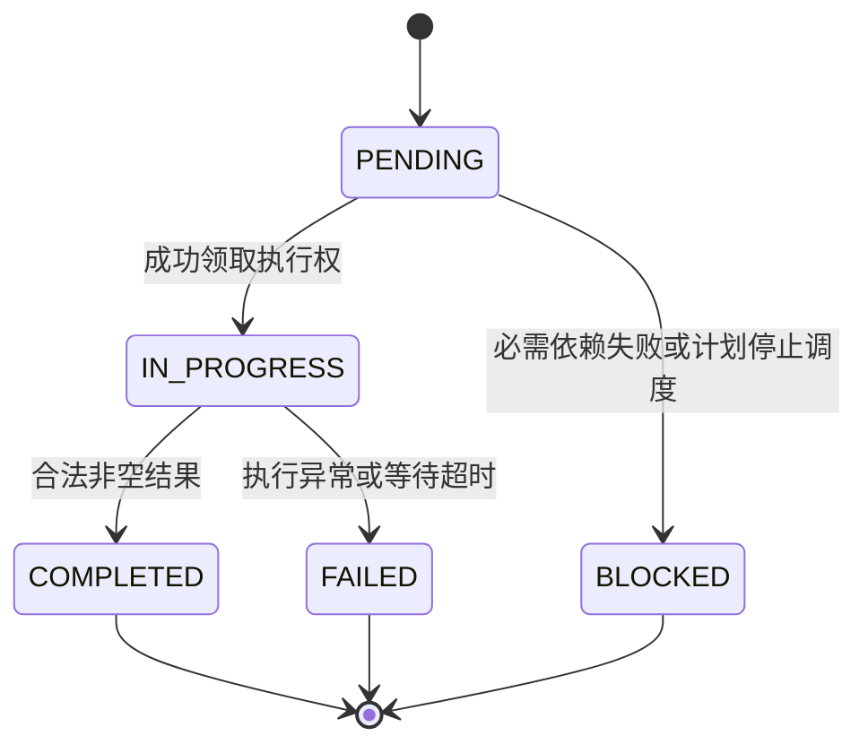

# 第六课：生命周期与失败传播

日期：2026-10-20。前置：[第五课实现记录](05-implementation.md)。本文件是下一课任务包，**第六课尚未实施或验收**。

本课目标：将分散在 Agent、编排器和回调中的状态写入收拢到统一边界，让失败原因、任务终态、计划结果和页面报告保持一致。连续完成下面六项关联任务，预留 4–6 小时；前端由助手配合，学习重点放在 Java。

## 1. 先理解：一次模型调用失败，分别影响谁

沿用工单草稿场景：A 提取事实，B 设计规则，C 依赖 A、B 进行审核。

- A 的模型调用失败：A 进入 FAILED，C 无法获得必需事实，应进入 BLOCKED。
- B 已经启动：让这次调用收敛并记录真实结果，不能因为 A 失败就伪造 B 的成功或宣称底层已停止。
- 整体计划：必需任务 A 失败，因此计划最终失败，不能拿 B 的文本作为整体成功结果。
- 执行 A 的工作 Agent：一次业务失败通常允许它继续接新任务，因此可从 BUSY 回到 IDLE；这不代表 A 任务成功。

| 对象 | 回答的问题 | 成功或失败的依据 |
| --- | --- | --- |
| Task | 这项业务工作做成了吗 | 输入有效、执行结果、终止原因 |
| Plan | 用户目标的必需任务全部完成了吗 | 所有必需任务成功，最终汇总成功 |
| Agent | 这个实例还能接工作吗 | 是否被占用、是否关闭、是否不可用 |
| HTTP / SSE | 这次连接还能收到响应吗 | 网络与请求生命周期 |

**连接断开不等于任务取消；Agent 回到空闲不等于任务完成。** 这些状态属于不同对象。

第五课已经处理了计划校验、任务输入、结构化错误和基本失败退出。本课为这些行为建立统一且可并发执行的规则。

## 2. 当前代码应该从哪里读起

按顺序看以下入口，每个入口只回答表中的一个问题：

| 入口 | 观察重点 |
| --- | --- |
| [Task](../../src/main/java/com/zxl/zxlaiagent/multiagent/model/Task.java) | status、result、error 和时间字段目前都是单独赋值 |
| [AbstractBaseAgent.executeTask](../../src/main/java/com/zxl/zxlaiagent/multiagent/agents/AbstractBaseAgent.java) | 工作实例占用、同步异常、Future 异常、空输出、状态释放 |
| [OrchestratorAgent.executeSingleTask / await](../../src/main/java/com/zxl/zxlaiagent/multiagent/orchestration/OrchestratorAgent.java) | 编排器也会写任务状态；等待超时后工作 Future 仍可能完成 |
| 同类的 orchestrate / synthesize | 计划失败、PENDING 转 BLOCKED、全部成功才汇总 |
| [WorkflowRun](../../src/main/java/com/zxl/zxlaiagent/multiagent/execution/WorkflowRun.java) | 报告已经有递增序号，但任务各字段仍可能读到不同时间的值 |
| [MultiAgentController](../../src/main/java/com/zxl/zxlaiagent/controller/MultiAgentController.java) | 如何把业务失败交给 HTTP / SSE；网络异常不能改写业务结果 |

例如：编排器等待超时，将任务写为 FAILED；稍后原 Future 返回，BaseAgent 仍可能把同一个任务写为 COMPLETED。`volatile` 只能保证单字段可见，不能让这些相关字段原子变化，也不能阻止终态倒退。

第五课额外捕获了 processTask 同步抛错，并用 BUSY → IDLE 的条件更新避免覆盖 SHUTDOWN。它们仍需在本课统一到完整的完成边界。

## 3. 定义本课必须成立的不变量

1. 一个 Task 只有一次终态决定；FAILED、BLOCKED、COMPLETED、CANCELLED 不能被迟到回调改写。
2. COMPLETED 必须与非空输出、结束时间同时成立；FAILED 必须与失败原因、结束时间同时成立。
3. 只有非空计划的所有必需任务都 COMPLETED，且必要的最终汇总成功，Plan 才能 COMPLETED。
4. 失败依赖的后继任务不能启动，也不能带空输出继续请求模型。
5. 执行权只由领取它的路径释放一次，SHUTDOWN 不能被完成回调恢复为 IDLE。
6. API、SSE 与观察记录读取同一个状态快照；报告发送失败不能把业务成功改成失败。

本课保留现有枚举名称 `COMPLETED`。不需要为了换成 `SUCCEEDED` 大范围重命名。

## 4. 允许的状态迁移

CANCELLED 已存在于枚举中，本课定义其终态保护，但真实取消传播、截止时间与底层调用停止留第七课。不要把 Future.cancel 的返回值直接当作业务操作已停止的证据。

Plan 建议规则：CREATED → IN_PROGRESS → COMPLETED / FAILED；规划阶段可以直接产生一个失败的执行结果，即使尚无合法 Plan。Agent 为 IDLE → BUSY → IDLE，SHUTDOWN 保持不可逆。需要重启的实例由明确的管理流程处理。

## 5. 六项工程任务

### 任务一：收拢 Task 状态写入

设计一个明确的状态所有者，例如 TaskLifecycle，提供 start、complete、fail、block、snapshot 方法。

- 状态、输出、错误码、错误路径、时间放入同一个不可变快照；通过 AtomicReference CAS 整体替换，或使用同一把锁保护全部字段。
- 不允许业务代码继续随处 setStatus / setResult / setError；只保留持久化或反序列化真正需要的入口。
- start 只接受 PENDING；complete / fail 只接受 IN_PROGRESS；block 只接受 PENDING。
- 重复回调返回明确的 transitionApplied=false，不重复发终态事件。
- 无效迁移保留原快照并记录原因，不能重新打开已结束的任务。
- 将第五课的计划入口校验与新的运行时快照衔接，不能因引入状态对象而允许模型伪造状态。

交付：状态迁移表、生命周期类、调用点替换。说明为什么只给 status 加 AtomicReference 仍不足以保证 result 与 status 一致。

### 任务二：建立 Agent 唯一完成边界

重构 AbstractBaseAgent.executeTask，使同步与异步结果都经过同一个完成函数。

覆盖 processTask 同步抛错、返回失败 Future、空结果、正常结果；若自定义 Agent 错误地返回 null Future，也应明确失败并释放占用。

- 获取执行权后立即建立清理边界；结束时按所有权释放 BUSY，不能无条件 state.set(IDLE)。
- Task 完成决定先于终态事件，事件中的数据来自已提交的不可变快照。
- 处理成功或失败时发生的观察者异常不能导致执行权泄漏。
- 若任务已被编排器终止，迟到结果只能记录为迟到观察，不能覆盖 Task 终态；这时仍需在底层真正结束后释放 Agent。

交付：一条统一完成路径和对应错误说明。不要假设 whenComplete / handle 内的代码永远不会抛异常。

### 任务三：区分失败因果与计划停止

定义结构化的失败信息，至少包含 code、message、sourceTaskId、blockedByTaskIds 和 reason。

- A FAILED 时，C 的原因是 DEPENDENCY_FAILED，并列出 A；不能只写“计划失败”。
- 对于未启动且与 A 无依赖关系的任务，如果采用遇错停止策略，用 PLAN_ABORTED 明确说明。
- 已启动的独立分支等待收敛，本课不谎报取消，也不启动它的后续节点。
- 沿依赖图传播，保持首次失败根因；C 阻塞造成 D 阻塞时仍能追到 A。
- 记录本课的调度策略：停止调度后续任务，等待已启动分支返回，再决定整体失败。

交付：A 失败时整张图的终态清单与根因。明确“因为输入不可能就绪”和“因为计划策略停止”是两种原因。

### 任务四：统一 Plan 结果与汇总结果

设计不可变的 WorkflowOutcome，包括 executionId、planId（可空）、整体状态、任务快照、失败原因、最终输出和统计。

- 计划尚未通过校验时也能返回失败 outcome，不创建假默认计划。
- allOf 成功只说明等待结束；整体成功仍必须核对任务不变量。
- 任意必需任务失败或阻塞，不调用最终 Supervisor 来粉饰为成功。
- 主任务全成功但额外汇总失败：任务保持真实成功，整体失败原因指向 synthesis。
- 最终 Supervisor 已是图中唯一汇合节点时复用其产物，避免重复模型调用。

交付：一个整体结束决策入口；与第五课已实现的无隐式降级策略保持一致。

### 任务五：页面和接口消费同一个结果

前端由助手实现，你负责结果契约。

- HTTP / SSE 的错误码与 outcome 一致，不再各自拼接不同的错误字符串。
- 任务卡显示失败根因、阻塞来源和实际结束时间；失败计划不会显示“整体完成”。
- completedTasks / totalTasks 是任务完成比例；100% 不意味着额外汇总已经成功。
- 接收端保持事件序号检查；终态报告发出后，不再被迟到 running 报告覆盖。
- 断线显示“结果未知”；本课仍不承诺刷新恢复。事件持久化与重放在第 20 课展开。

交付：成功、失败、阻塞、连接中断四种页面状态的可复核记录。

### 任务六：集中验收，并练习讲解

先用可控的 Agent 替身验证状态与因果，再用真实模型演示一次正常工单流程。替身应能控制完成时机和抛错，不依赖模型随机输出制造故障。

下面是下一课验收矩阵，当前没有执行这些专项用例：

| 场景 | 必须观察到的结果 |
| --- | --- |
| A、B 成功，C 成功 | 三个任务与整体成功，输出完整 |
| A 失败，B 已启动 | A FAILED；B 保留真实结果；C BLOCKED；整体失败 |
| A 同步抛错 / 异步失败 | 同一失败路径，Agent 可重新领取任务 |
| 空输出 / null Future | 明确失败，任务与执行权都收敛 |
| 等待超时后成功回调晚到 | Task 保持 FAILED，迟到结果不能覆盖 |
| 同一终态回调两次 | 只有一次状态决定与一次终态通知 |
| 执行过程中 Agent shutdown | 完成后不恢复成 IDLE |
| 业务完成但报告订阅者抛错 | 业务结果不变，连接错误单独记录 |
| 全部主任务完成，额外汇总失败 | 主任务成功，Plan 失败，原因指向汇总 |
| 规划失败，无有效 Plan | outcome 失败，业务工作 Agent 没有开始 |

这些是第六课任务要求，实施时按你的验收安排运行；第五课记录不宣称已覆盖它们。

## 6. 建议分两批连续完成

第一批：任务一、二、三，建立状态所有者、完成边界、依赖失败因果。

第二批：任务四、五、六，接通整体结果、页面与集中验收。每个职责完成后维护说明、细粒度提交并 push，最后集中演示，不逐行断点。

## 7. 面试时要能回答

1. 为什么一个 CompletableFuture 正常结束，仍不能直接判定整个计划成功？
2. 为什么 Task、Plan、Agent 和 HTTP 需要不同状态？
3. 任务超时后晚到的成功结果如何处理？取消调用与终态保护有什么区别？
4. CAS 更新 status 与 CAS 更新不可变执行快照，有什么不同？
5. 一个分支失败时，独立分支继续还是停止？你的实现选了哪种策略，如何向用户解释？
6. 事件发送失败是否应该回滚业务结果？如何避免双重终态？
7. 如果服务重启，这套内存状态机制还保证什么？哪些问题必须靠持久化、租约和幂等解决？

建议用 3 分钟讲清“事实提取失败 → 审核阻塞 → 计划失败 → Agent 恢复可用”的全过程，再指出当前单进程实现的边界。

## 8. 阅读与后续

沿用[源码导读的 S2](reference-guide.md)，对照 Shannon 的任务等待与结束决策，写出你在 Java 中采用的状态所有者和失败策略；不要直接把其他语言工作流代码当作本项目已经具备的能力。

本课完成后，第七课继续处理截止时间、真实取消传播、资源配额与排队；第八课处理可重试错误、退避和业务幂等。第六课建立终态保护，是这些机制共同的前提。
