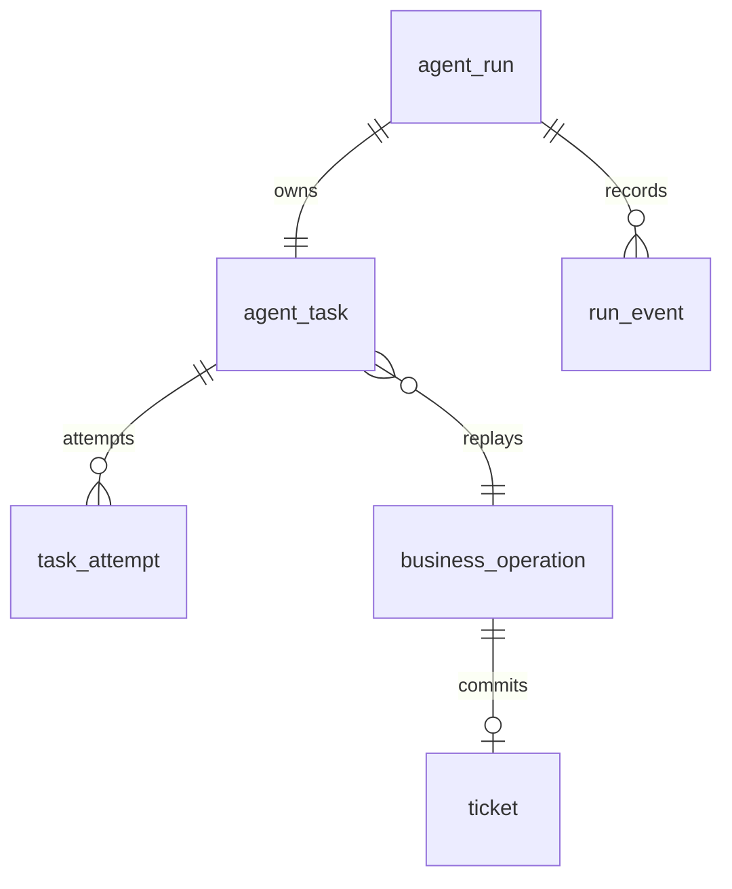

# 第九课实现记录：持久任务与故障恢复

日期：2026-10-22。前置：[完整学习任务](09-persistence-and-recovery.md)。

## 1. 先理解本次完成什么

第八课用内存账本保证同一次 JVM 生命周期内的工单去重。本课把业务事实写入文件数据库，重新启动 JVM 后读取原运行与工单，并按原截止时间恢复尚未开始或租约过期的任务。恢复创建新的 attempt，不恢复旧线程或 Future。

这是显式 `lesson9-demo` profile 的本地单用户工单实验：每个 run 恰好一个 `CREATE_TICKET` 任务。未替换已有多 Agent 编排的内存权威，未实现任意 DAG、模型会话或外部工具的恢复，也没有新增独立 Agent 页面。

## 2. 代码地图

以下 Java 路径以 `src/main/java/com/zxl/zxlaiagent/` 为根。

| 文件 | 责任 |
| --- | --- |
| `persistence/LessonDatabase.java` | 显式 Flyway 迁移、连接、提交与回滚、新鲜数据库时间 |
| `persistence/PersistentModels.java` | Run、Task、Attempt、Event、Ticket、Snapshot、Claim 数据事实 |
| `persistence/PersistentWorkflowRepository.java` | 聚合六表业务事务、领取、续租、完成、取消、扫描和查询 |
| `persistence/PersistentWorker.java` | 启动恢复、有限批量扫描、固定执行线程和有界队列 |
| `persistence/Lesson9Configuration.java` | 仅演示 profile 注册依赖，不建立全局 DataSource |
| `controller/LearningPersistenceController.java` | 本地 HTTP 运行接收、读取、取消和恢复入口 |
| `src/main/resources/db/lesson9/V1__persistent_ticket_workflow.sql` | 六表、唯一键、索引及外键；Flyway 历史表独立命名 |

复用 `ticket/TicketCommand.java` 的参数规范化与 SHA-256 指纹，没有另造一个不兼容的工单契约。

## 3. 数据关系与状态



operation 的逻辑唯一键是 `(scope, operation_type, operation_id)`，当前 scope 固定 `lesson9-demo`。ticket 的 operation ID 唯一；同一 operation 可被多个 run 引用，所以换 run ID 不会绕过去重。跨表业务关联通过短事务和固定教学作用域维持，非每条逻辑关联都有物理外键。不得把演示 scope 当作租户认证。

| 当前状态 | 触发 | 新状态及事实 |
| --- | --- | --- |
| PENDING | 有效领取 | RUNNING；新 attempt、fence token +1、设置 owner/lease |
| RUNNING 且租约有效 | 其他 worker 领取 | 不领取；不新增 attempt |
| RUNNING 且租约过期 | 再领取 | 旧 attempt EXPIRED，新 attempt、新 token |
| PENDING/RUNNING | 原 deadline 到期 | TIMED_OUT；无工单写入 |
| PENDING/RUNNING | 持久取消 | CANCELLED；清空租约，运行中的 attempt 同步终止 |
| RUNNING | 有效 owner/token/lease 提交 | SUCCEEDED；同事务写工单/操作结果/完成/事件 |
| 可恢复任务已尝试 5 次 | 再次领取 | FAILED，错误 ATTEMPT_LIMIT |
| 任意终态 | 再扫描/取消 | 保留原终态与结果，不自动重跑 |

取消与完成由同一 run 行锁串行化：完成先提交则取消返回原成功；取消先提交则后来的完成返回 false。取消不会删除已经产生的工单。

## 4. 为什么不会凭旧身份提交

领取先锁 run，读取 task 版本，再用带 version、状态和租约条件的 UPDATE；只有成功后才增加 attempt。续租与完成检查任务 ID、owner、递增 token、RUNNING、原 deadline 和有效 lease。所有状态条件更新检查受影响行数。

完成锁住 operation 后再次读数据库时间，防止等待另一个工单事务的过程中租约失效。PostgreSQL `CURRENT_TIMESTAMP` 固定在事务开始，因此时钟查询使用另一个自动提交连接，取当前数据库时间，而不是应用机器时间。

所有业务查询/更新及数据库时钟语句设 5 秒 query timeout。它限制等待，不证明请求没有提交；连接建立/网络超时仍需 JDBC URL 配置，例如 PostgreSQL 的 `connectTimeout=5&socketTimeout=10`。数据库返回不确定时不生成新的 operation ID，后续查询原运行/操作结果。

工单完全在同库完成：锁 operation、插入 ticket、保存结果、结束 task/attempt/run、写事件一起提交或回滚。并发预留相同 operation 的唯一冲突用 savepoint 回滚该次插入后再读取既有行，兼容 PostgreSQL 事务失败语义。没有跨系统 exactly-once 保证。

## 5. 启动与操作

保留已有本地配置，在额外端口启动带演示 profile 的应用：

```powershell
mvn spring-boot:run '-Dspring-boot.run.arguments=--spring.profiles.include=lesson9-demo --server.port=8129'
```

默认 `jdbc:h2:file:./runtime-data/lesson9/workflow`，自动创建文件数据库并执行 Flyway V1。运行数据在 Git 忽略目录；不要删除数据库后再宣称重启恢复。H2 默认用于单进程文件实验，不宣称已经验证多实例共享访问。生产数据库和本地密钥不提交。

可选环境变量：`LESSON9_JDBC_URL`、`LESSON9_JDBC_USER`、`LESSON9_JDBC_PASSWORD`、`LESSON9_WORKER_ENABLED`。PostgreSQL URL 采用 `jdbc:postgresql://127.0.0.1:5432/agent_learning?connectTimeout=5&socketTimeout=10`，使用专用学习库；PostgreSQL 尚未实际运行验收。

相对于应用 context path 的 API：

| 请求 | 作用 |
| --- | --- |
| `POST /ai/learning/persistent-runs` | 接收运行，立即返回持久化的 PENDING；worker 异步执行 |
| `GET /ai/learning/persistent-runs/{id}` | 数据库快照：run/task/attempts/events/ticket |
| `POST /ai/learning/persistent-runs/{id}/cancel` | 持久取消；终态保持原结果 |
| `POST /ai/learning/persistent-runs/recover` | 触发一次有界扫描，返回实际入队数量；禁用 worker 时返回 0 |

创建 body：

```json
{"operationId":"lesson9-my-ticket-001","title":"VPN access request","description":"local exercise","timeoutMs":60000}
```

请按当前应用 context path 设置 `$base`（已有应用常见 `/api`；独立演示入口没有此前缀）：

```powershell
$base = 'http://127.0.0.1:8129/api/ai/learning/persistent-runs'
$body = '{"operationId":"lesson9-my-ticket-001","title":"VPN access request","description":"local exercise","timeoutMs":60000}'
$run = Invoke-RestMethod -Method Post -Uri $base -ContentType 'application/json' -Body $body
Invoke-RestMethod -Uri "$base/$($run.id)"
```

首次结果可能仍为 PENDING/RUNNING；稍后再次查询。重复相同 body 会创建新 run，但成功后返回同一个 ticket ID、事件 `replayed=true`；同 operation ID 改参数返回 HTTP 409。不存在 run 返回 404，非法参数 400。这里 operation ID 去重业务动作，不承担 HTTP 接收 run 的去重。

`timeoutMs` 为 1–3600000，默认 60000。固定 2 个执行线程、最多 8 个等待任务、每秒最多扫描 10 个候选；数据库保留未入队工作。默认租约 5000ms，每任务最多 5 次领取。当前本地工单事务很短，worker 不启动长调用心跳；仓储提供 `renew`，将来接长活动必须安排有界心跳并重审失败边界。

阅读顺序：先看 create 的原子接收，再看 claim 的竞争条件，随后读 complete 的同库提交，最后看 recoverable/worker 的有界恢复。观察 GET 的 attempts 和 events 即可理解，无需逐行断点。

## 6. 本次实际证据

本次没有新增或运行自动测试。编译与业务演示分别记录：

- `mvn -q -DskipTests compile` 成功；不是自动测试通过。
- 文件 H2 2.3.232，Flyway V1 实际迁移成功，重启后验证无待执行迁移。Flyway 提示该 H2 版本较其声明支持范围新；不把该提示描述为生产兼容认证。
- 独立 Java 进程分别创建、领取、完成、查询同一文件数据库，原 run、deadline、attempt、工单与事件保留。
- 临时窄 Spring MVC 入口加载本次配置和真实 Controller，端口 18129；未扫描原模型/RAG 组件。真实 HTTP POST/GET 后 worker 完成工单；相同 operation 新 run 重放原 ticket ID；改参数返回 409。
- 禁用 worker 后 HTTP 创建 PENDING、1ms 截止和 CANCELLED 三个运行，停止该演示 JVM，再启用 worker 重启同一数据库：待执行运行自动完成；过期运行 TIMED_OUT 且 attempt=0、ticket=null、原 deadline 不变；取消运行保留 CANCELLED。
- 连续两次恢复请求均 `queued=0`，已完成运行未新增 attempt；原工单 ID 与原事件保留。
- 独立进程演示过期租约：worker-old 获 token=1、1ms lease，稍后 worker-new 获 token=2；旧身份完成返回 false，新身份完成返回 true；历史 attempt 1 为 EXPIRED、attempt 2 为 SUCCEEDED，只有新身份提交本地工单。此项是顺序受控演示，不是并发压力测试。

上述临时入口和数据库位于 `target/`，不提交。原 8123 服务未停止。这里只验证本地演示 API，不代表原应用完整配置下的全量启动、页面演示或现有多 Agent 运行已接入持久仓储。

### 尚未覆盖

PostgreSQL 实跑、多实例高并发竞争、数据库断连/提交前故障注入、外部响应不确定、生产身份权限、容量/性能、数据保留和清理均未验收。没有调用真实模型、外部工单，也没有声称持久化 Neo4j 或 GraphRAG。学习掌握状态仍由你自己填写。
