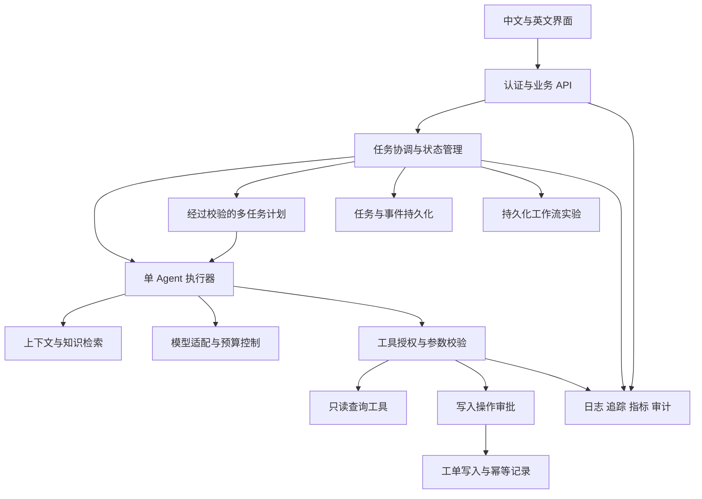

# 企业级 Agent 工程实践与面试路线

制定日期：2026-10-16。适合能写 Spring Boot 接口、正在从零学习 Agent 的开发者。

目标：能够独立设计、实现、部署和排查一个有明确业务边界的 Agent 应用，并在面试中用代码、运行记录和设计决策解释自己的工作。课程知识、先修关系和代码证据现同步维护在前端 `/learning`；图谱建模与维护也作为课程知识的一部分，详见[图谱维护指南](graph/README.md)。

这份路线将原来的 8 课扩展为 28 课。第一课按你的反馈记为已学完，第二课工具链路已接通，第三课四项工程任务已实现并完成专项验收。第四课的统一会话、历史与上下文恢复已实现，证据与边界见[实现记录](04-implementation.md)；第五课已实现计划校验、依赖数据流与真实页面报告，[实现记录](05-implementation.md) 单独列明未覆盖矩阵；第六课已实现原子状态与失败传播，[验收记录](06-implementation.md) 包含 48 个专项与相关回归及页面证据；第七课六项任务已实现并通过受控自动化验收，[验收记录](07-implementation.md) 区分了真实模型和生产边界。第八课单进程重试与工单幂等已实现，12 项新增专项及 4 项预算回归通过，见[验收记录](08-implementation.md)。第九课已发布[持久化与恢复任务包](09-persistence-and-recovery.md)，工程待实现。工程完成与个人掌握分别记录，是否掌握通过个人学习状态与独立练习体现。

## 1. 两份参考资料怎样使用

| 资料 | 在课程中的用途 | 具体学习方式 |
| --- | --- | --- |
| [ai-agent-book](https://github.com/bojieli/ai-agent-book) | 原理、实验方法和评估思路 | 按主题选读章节，在当前 Java 项目中实现对应机制；必要时运行一个小型 Python 对照实验 |
| [Shannon](https://github.com/Kocoro-lab/Shannon) | 对照工程中的职责划分、任务控制和治理机制 | 从一个问题追到相关文档与关键源码，再设计 Java 实现并用故障场景验收 |
| 当前 zxl-Ai-agent | 连续迭代的主项目 | 保留 Java / Spring Boot / Vue 主线，逐步补齐业务闭环、持久化、权限、可靠性和运维能力 |

参考资料的固定提交、阅读入口和已发现的边界见 [参考资料与源码导读](reference-guide.md)。书中章节编号按本次核对的 2.0 目录使用。

Shannon 的主架构涉及 Go、Rust、Python 与 Temporal。课程优先学习职责与机制，通过 Java 实践理解；选择原框架和自建模块时，要能解释交付成本、维护成本与已有团队技术栈的取舍。

## 2. 贯穿课程的业务应用

业务主线已于 2026-10-16 确定为 **企业知识库与工单协作助手**。课程中的知识检索、身份与租户隔离、人工审批、多 Agent 协作和工程验收均围绕这条业务链展开。

一条完整业务链路：

1. 用户提出问题，例如“查询 VPN 故障处理办法，必要时帮我创建工单”。
2. 应用从认证信息确定用户、租户和角色，准备会话与可用工具。
3. 检索用户有权限访问的知识，查询相关工单，整理可核查的证据。
4. 简单问题直接回答；需要多个步骤时，生成并校验任务计划。
5. 需要写入时，生成可审查的工单草稿，校验权限并等待人工审批。
6. 审批通过后执行绑定的操作，用幂等记录防止重复写入。
7. 返回引用、执行状态和工单编号，并保留任务、工具、成本和审计记录。

实践使用合成知识文档、两个演示租户和本地工单服务。最终应完成真实的本地 API 与数据库读写；生产系统连接按目标企业的接入与权限要求另行实施。

### 逐步演进的结构

这是目标职责图，表示逐课建设的模块；模块起步放在同一应用中。服务拆分需要有部署、隔离或容量方面的实际依据。

## 3. 28 课完整课程表

每课包含概念、代码导读、工程改动、运行验收、独立练习和面试追问。复杂课程可拆成多个 45–60 分钟学习单元，进度由工程验收决定。

参考栏：B 表示书的章节，S 表示 [源码导读](reference-guide.md) 中的 Shannon 阅读入口；“自定实践”表示本课程为业务目标设计的工程内容。

### 阶段一：掌握一个 Agent 的执行链路

| 课次 | 主题 | 工程实践 | 完成标准与面试追问 | 参考 |
| --- | --- | --- | --- | --- |
| 1，已学完 | 模型、消息与上下文 | 追踪 LoveApp、会话记忆与 ZxlManus | 能解释每次请求带了什么、模型与应用各负责什么 | B1、B2 |
| 2，进行中 | 真实工具调用 | 添加时间工具，注册回调，在页面观察实时思考、执行和结果回填 | 读取真实工具卡片并核对最终回答；解释只加注解还缺哪些步骤 | B2、B4 |
| 3，工程已验收 | 执行循环与工具结果契约 | [预算、结束原因与统一工具结果](03-agent-loop-and-results.md)，[48 个专项用例与页面验收](03-acceptance.md)；模型生成计划的 JSON 校验在第 5 课继续 | 不把调用失败当成正常完成；解释格式正确与业务正确的区别 | B1、B4、B5 |
| 4，工程已实现 | 会话与记忆 | [会话、历史存储与上下文恢复](04-conversations-and-memory.md)，[统一类型、仓储与页面记录](04-implementation.md) | 同会话能恢复、不同会话隔离；解释会话记录与模型上下文的区别 | B3 |

### 阶段二：优先补齐多 Agent 编排可靠性

| 课次 | 主题 | 工程实践 | 完成标准与面试追问 | 参考 |
| --- | --- | --- | --- | --- |
| 5，工程已实现 | Plan、Task 与依赖数据流 | [六项任务](05-plans-tasks-and-dataflow.md)与[实现证据](05-implementation.md)：严格计划、DAG 校验、依赖输出和真实报告 | 下游能读到真实上游结果；能解释何时并行及何时无需多 Agent | B10、S1、S2 |
| 6，工程已验收 | 生命周期与失败传播 | [六项任务](06-lifecycle-and-failure-propagation.md)与[验收记录](06-implementation.md)：原子状态、终态保护、失败因果和统一结果 | 上游失败不会触发伪造的整体成功；解释状态不变量 | S2、自定实践 |
| 7，工程已实现并通过受控验收 | 超时、取消与并发 | [六项任务](07-deadlines-cancellation-and-capacity.md)与[验收记录](07-implementation.md)：共享截止时间、协作取消、实际清理、有界队列和容量边界 | 区分请求超时和底层操作停止；取消后不再启动新的任务 | S2、自定实践 |
| 8，单进程工程已实现并受控验收 | 重试与幂等 | [六个学习单元](08-retries-and-idempotency.md)和[验收记录](08-implementation.md)：明确错误分类、有限 jitter 退避、共享预算、操作 ID/参数摘要、工单原子去重 | 12 项新增专项与 4 项预算回归通过；同进程响应丢失后重试返回原工单；不覆盖重启和多实例 | S2、自定实践 |

### 阶段三：任务持久化与故障恢复

| 课次 | 主题 | 工程实践 | 完成标准与面试追问 | 参考 |
| --- | --- | --- | --- | --- |
| 9，任务包已发布、工程待实现 | 数据建模与任务恢复 | [六项完整任务](09-persistence-and-recovery.md)：Run/Task/Attempt/Operation/Event/Ticket、短事务、版本 CAS、租约/fencing 和重启恢复 | 待验收：重启查询、同库去重、竞争领取、旧 token 拒绝、deadline 保留；区分领取唯一与外部执行停止 | 自定实践 |
| 10 | 持久化工作流 | 用 Temporal Java SDK 做一个有外部操作的工作流实验，对照自建任务恢复机制 | 重启 worker 后任务可继续；解释确定性回放、Activity 重试和幂等责任 | S1、S2 |

第 9 课将第 8 课的操作记录持久化，补上重启后的去重与恢复，用于理解状态与并发问题；第 10 课用于比较和选型。主项目在完成架构决策后选定一种协调方式，明确状态的权威来源，避免两套调度器同时驱动同一任务。

### 阶段四：上下文工程与可核查的知识能力

| 课次 | 主题 | 工程实践 | 完成标准与面试追问 | 参考 |
| --- | --- | --- | --- | --- |
| 11 | 上下文工程 | 分配消息与工具结果预算，裁剪与摘要，提示模板版本化；用对照任务观察缓存相关影响 | 长任务保留必要依据；解释上下文、输出长度、成本和质量的关系 | B2 |
| 12 | 知识接入与索引 | 文档解析、分块、Embedding、文档与分块元数据、增量更新和删除 | 文档变更可追踪，删除后不能继续被召回；解释分块选择 | B3、自定实践 |
| 13 | 检索与重排 | 建立向量检索基线，再比较关键词检索、混合检索、重排及查询改写 | 同一批问题能比较召回与最终回答效果；解释优化是否值得 | B3、B7 |
| 14 | 引用、拒答与长期记忆 | 将证据关联到文档版本和片段；无依据时澄清或拒答；区分用户事实与任务临时信息 | 引用可定位，记忆可更正和删除；解释错误记忆如何影响回答 | B3、B7、自定实践 |

知识与记忆的仓储从设计时保留身份、租户和授权范围；第 17 课统一接入可信认证信息并验证所有访问路径。

### 阶段五：工具生态与安全业务执行

| 课次 | 主题 | 工程实践 | 完成标准与面试追问 | 参考 |
| --- | --- | --- | --- | --- |
| 15 | 工具契约与 MCP | 设计工具参数、结果、错误和超时契约；让 ResearchAgent 使用真实检索工具；接入一个远程只读 MCP 工具 | 工具可发现、可调用、可解释失败；能比较本地工具与远程协议 | B4、S1 |
| 16 | Skills 与业务策略 | 以版本化声明组织业务步骤、提示模板、输出要求和可用工具范围 | 更换业务策略可追踪版本；解释 Skill、Prompt、Tool 和工作流的职责 | B2、S3 |
| 17 | 身份、权限与租户隔离 | 接入认证，在接口、任务、会话、向量检索、缓存和工具执行中实施授权 | 两个租户不能读取对方数据，身份不取自模型自报参数 | S6、自定实践 |
| 18 | 注入防护与运行隔离 | 区分外部资料与可信控制信息；工具最小权限、文件与网络边界、独立运行环境、日志脱敏 | 恶意文档不能绕过工具授权；能说明隔离的覆盖范围与残余风险 | B4、B5、S4 |
| 19 | 人工审批与业务写入 | 审批绑定动作、参数摘要、操作 ID、审批者、过期时间和版本；恢复后再校验 | 拒绝、过期或参数变更时不执行；审批通过的重复回调不会重复写入 | S5、自定实践 |

### 阶段六：让运行过程可观察、效果可评估、成本可解释

| 课次 | 主题 | 工程实践 | 完成标准与面试追问 | 参考 |
| --- | --- | --- | --- | --- |
| 20 | 执行事件与流式交互 | 在第 5 课真实快照与序号基础上完善事件持久化、断线续传、快照与结果恢复 | 页面重连后状态一致；解释 SSE 重连、事件重复和任务取消的区别 | S7、自定实践 |
| 21 | 日志、指标与 Trace | 关联 runId/taskId/toolCallId；修复耗时统计，在第六课本地任务耗时基础上记录模型 / 工具延迟、错误和用量 | 能从一次失败定位到具体调用；解释 p95、首字延迟和端到端耗时 | S1、B7、自定实践 |
| 22 | 评估与持续改进 | 建立固定任务集、规则评分、必要的人工复核与模型评分校准；对失败轨迹分类 | 同一数据集可比较变更前后结果，开发集与保留集分开 | B7、B9 |
| 23 | 预算、路由与降级 | 记录真实 usage，做预算预留与结算、调用次数限制、模型路由和有限降级 | 并发任务不能绕过预算检查；区分本地估算、返回用量和实际账单 | S8、B7、自定实践 |

### 阶段七：交付、演练与面试

| 课次 | 主题 | 工程实践 | 完成标准与面试追问 | 参考 |
| --- | --- | --- | --- | --- |
| 24 | 可复现部署与交付 | 容器化、环境配置、健康检查、数据库迁移、依赖锁定、回归检查、流水线和回滚；单独评估现有 M6 依赖升级 | 新环境能按文档启动；流水线执行必要的自动检查，升级有兼容性证据和回退路径 | S9、自定实践 |
| 25 | 容量与性能 | 分开测本地组件和真实模型链路；队列、背压、连接池、租户公平性及供应商限额 | 在注明环境与负载下报告吞吐、延迟、错误和成本；解释瓶颈 | 自定实践 |
| 26 | 故障演练 | 模型断连、数据库失败、worker 重启、审批超时、重复提交、事件重连与预算不足 | 对每个场景给出预期状态、实际记录和恢复结果，确认没有重复业务写入 | S2、S5、S7、自定实践 |
| 27 | 完整项目验收与架构复盘 | 演示两租户业务链路，提交架构决策、数据模型、部署说明和质量报告 | 独立完成一次需求变更，解释业务价值、设计取舍、局限和证据 | 全课程 |
| 28 | 面试与独立设计 | 项目介绍、代码追问、故障分析、系统设计、现场小改动；补齐目标岗位的 Java 基础 | 能独立答题、定位代码并实现改动；把未通过项转为补练任务 | 全课程 |

## 4. 按里程碑判断是否掌握

| 里程碑 | 对应课程 | 必须提交的证据 |
| --- | --- | --- |
| M1：单 Agent 闭环 | 1–4 | 工具调用请求、真实结果、完整最终输出、会话恢复记录 |
| M2：可靠任务协作 | 5–8 | 依赖数据传递、失败阻塞、取消和重复请求的运行记录 |
| M3：重启后可恢复 | 9–10 | 数据模型、worker 重启演示、两种协调方式的选型说明 |
| M4：知识回答有依据 | 11–14 | 有版本的资料集、检索对比、引用与无依据场景、记忆删除记录 |
| M5：业务执行受控 | 15–19 | 真实工具与 MCP 调用、两租户授权检查、审批及幂等写入记录 |
| M6：运行可解释 | 20–23 | 事件恢复、Trace、固定任务集报告、用量与预算记录 |
| M7：能交付并说明取舍 | 24–28 | 可复现部署、容量基线、故障演练报告、独立改动和模拟面试记录 |

从第二课起就为每个小实验定义输入、预期和证据；第 22 课把逐步积累的案例整理为统一评估集。

自动化验证也属于要学习的工程能力：工具与状态机用单元测试，仓储与 API 用集成测试，远程工具用契约检查，完整任务用端到端案例和质量评估。采用可控模型与工具替身检查确定性逻辑，再单独记录真实模型运行结果。具体代码和执行安排在对应实战中展开，本次课程规划未新增或运行项目测试。

### 毕业任务集的起点

先设计 30 个业务案例，随实践补充难例。它们是课程验收起点，不能代表所有生产场景。

| 案例类别 | 初始数量 | 判断依据 |
| --- | --- | --- |
| 有依据和无依据的知识问答 | 8 | 正确性、引用可定位、适当澄清或拒答 |
| 工具及业务操作 | 6 | 工具选择、参数、返回值、业务结果 |
| 多任务依赖 | 5 | 数据传递、计划校验、终态一致 |
| 故障与恢复 | 5 | 预期状态、资源清理、恢复与幂等 |
| 权限与恶意输入 | 4 | 授权规则、数据隔离、写入边界 |
| 预算与降级 | 2 | 预算记录、受控停止、降级结果 |

安全与状态不变量按预先定义的规则逐条验收；回答质量单独评分。性能指标先在明确环境下测基线，再设目标；课程不预先声称某个并发量、延迟或成功率已经达到。

### 毕业时的项目材料

- 可运行的仓库、版本固定的依赖与启动文档。
- 一页架构图、核心数据模型与至少四份架构决策记录。
- 一组成功和失败任务的脱敏执行记录。
- 一份评估报告，包含任务集版本、模型与配置、结果和局限。
- 一组可重复执行的自动检查，覆盖核心状态、工具契约、数据访问和业务闭环。
- 一份容量基线与故障恢复报告。
- 可独立演示的业务闭环，以及一个现场需求变更的实现记录。
- 基于真实工作写出的简历内容、项目介绍和追问清单。

## 5. 每课怎样一起学

按你在 2026-10-16 的反馈，每次围绕一个完整功能单元安排一批相关任务，集中讲解后由你连续实现，再统一检查与复盘；不再按几行代码拆分反馈。

1. **先讲概念。** 从熟悉的 Java 后端概念出发，解释本次要解决的问题。
2. **定位当前代码。** 画出输入、状态、输出和依赖，只读本课相关链路。
3. **做一个小改动。** 先让你实现关键部分，再逐段讨论，逐步减少提示。
4. **运行并收集证据。** 在页面查看真实执行事件、工具结果和业务变化，明确正常与失败的预期。遇到具体故障时再选择日志、断点等定位手段。
5. **独立变式练习。** 换一个参数、业务规则或故障条件，由你独立完成。
6. **面试复盘。** 每课整理 3–5 个追问，练习“问题 → 方案 → 取舍 → 证据 → 局限”的表达。

课程文档与项目实现分别记录进度。修改是否有效，要用相应的运行或评估证据说明；尚未运行的示例标明为参考实现。

## 6. 必须说清的工程边界

- 多 Agent 的价值需要与更简单的方案比较，并用任务效果、成本和延迟说明。
- 提示词与模型自报的身份不能替代服务端授权；授权应覆盖检索前和实际工具执行时。
- 超时返回、浏览器断连和取消底层动作是不同事件，需要分别处理。
- 工作流回放依赖已记录的历史；外部操作重试仍需要业务幂等，不能据此承诺所有操作天然“只执行一次”。
- 对有副作用的动作，审批后再次校验参数、身份与资源状态；存在跨系统一致性问题时设计补偿或人工处理路径。
- 预算控制要说明估算误差、并发预留、在途请求与账单差异；模型或工作流框架不能替代这套核算。
- 使用沙箱要说明文件、网络、凭据、CPU、内存与执行时长的边界；一种沙箱机制不能自动保护所有工具。
- 面试准备面向 Agent 应用与平台工程；模型训练、强化学习和 GPU 集群运维属于另外的深化方向。

## 7. 当前从哪里继续

前四课的模型、工具、循环与会话工程链路已接通。第四课的构建、真实模型连续对话及未覆盖范围见[实现记录](04-implementation.md)。第五课的 Plan / Task 校验、依赖数据流与真实报告已实现，构建和页面观察见[实现记录](05-implementation.md)。第六课的原子状态、失败传播与统一结果已实现并集中验收，见[记录](06-implementation.md)。第七课的截止时间、取消与容量已通过受控验收；第八课[重试与幂等](08-retries-and-idempotency.md)及[验收](08-implementation.md)已完成单进程实验。接下来学习[第九课任务持久化与恢复](09-persistence-and-recovery.md)，将运行事实与幂等结果写入数据库。

课程开始工程改动前，先解决该次实验所需的启动阻断、凭据外置与依赖配置。当前后端初始化、MCP 获取及前端进度等缺口见 [课程地图](README.md) 与 [项目 README](../../README.md)。这些缺口也会转为有明确范围的工程练习。

Java 集合、并发、JVM、Spring、数据库、缓存和基础算法按目标岗位并行补练。课程中会结合线程池、事务、锁、队列和故障场景学习相应基础。

## 8. 延伸方向

完成主线后，可按业务继续探索多模态、浏览器操作、Coding Agent、知识图谱、模型后训练和更复杂的协作策略。对应书中第 5、6、8、9、10 章，选题时重新核对章节与实验状态。

具体面试结果取决于岗位要求与实际掌握程度。本路线用独立设计、编码、排障和表达的证据帮助判断准备程度，随后针对目标职位补练。
